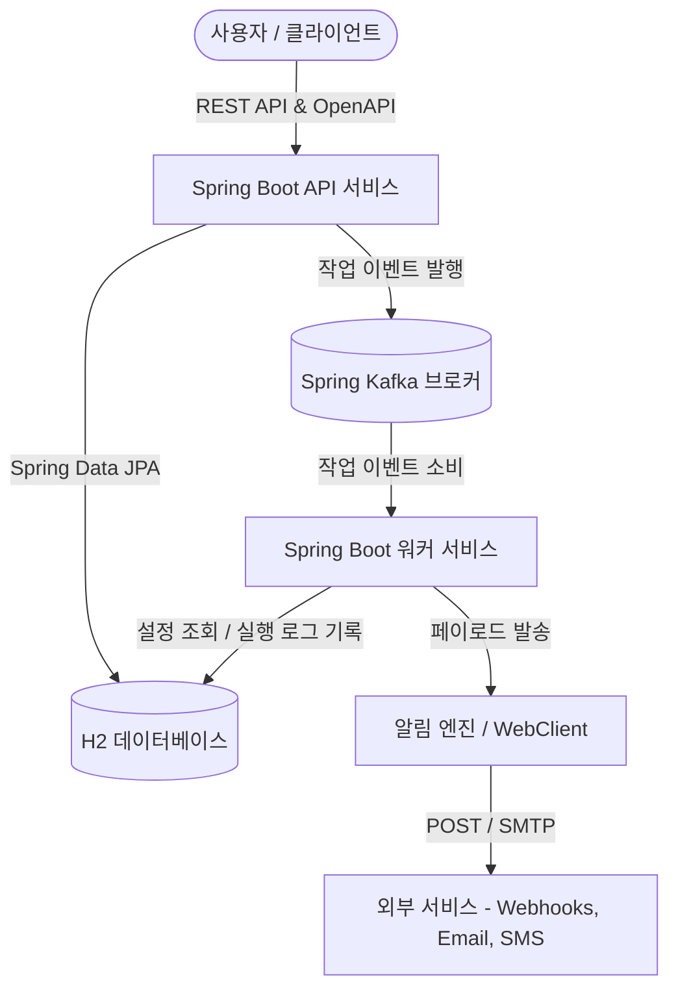

# 알림 발송 시스템

## 1. 요구사항 분석
- 기능: 알림 API, Kafka 연동
  - 알림 CRUD 및 이력 조회 기능 제공 (Spring Boot API Service, `/alarms` 엔드포인트)
  - 알림 즉시 발생 기능 제공 (`POST /alarms/{id}/trigger` 엔드포인트)
  - 즉시 발송 중심 설계: 모든 도메인, 서비스, 어댑터, DTO에서 예약 관련 시간 스펙(`scheduledAt`) 제거
  - Kafka 기반 비동기 멱등성 제어 및 메시지 큐 연동
  - 외부 Mock API 서버 연동 (`NotificationPort` 및 `MockApiNotificationAdapter` 구현)
  - 동작 검증: 즉시 발송 및 Kafka 비동기 멱등성 연동 검증용 통합 테스트 제공 (`AlarmImmediateTriggerTest.kt`, `AlarmKafkaIntegrationTest.kt`)
- 비기능 (발굴):
  - 중복 발송 -> 멱등성 키: 네트워크 재시도나 중복 요청으로 인한 동일 알림의 이중 발송 방지
  - 장애 내구성 -> MQ 기반: Kafka Broker 및 재시도/DLT(Dead Letter Topic) 구성을 통해 일시적 장애 극복
  - 채널 확장성 -> 전략 패턴: Webhook, Email, SMS 등 다양한 발송 채널 추가에 유연하게 대응할 수 있도록 추상화 인터페이스 구성

## 2. 아키텍처 다이어그램


### 2.1. Kafka 기반 비동기 멱등성 처리 흐름
- **발행 (Producer)**: 사용자가 `POST /alarms/{id}/trigger`를 통해 즉시 발송을 요청하면, `KafkaAlarmJobProducer`가 `MessageQueuePort`를 통해 알림 이벤트를 Kafka 브로커로 발행합니다.
- **소비 (Consumer)**: `KafkaAlarmJobConsumer`가 Kafka 브로커로부터 이벤트를 비동기적으로 전달받아, 중복 처리를 방지하기 위해 로컬 락 및 데이터베이스 상태 체크를 거쳐 멱등성을 보장하며 `NotificationPort`를 통해 알림을 전송합니다.

### 2.2. 로컬 실행 방법
Zookeeper 및 Kafka 환경을 Docker Compose를 활용해 기동한 후 애플리케이션을 테스트할 수 있습니다.
1. **Kafka 컨테이너 실행**:
   프로젝트 루트 경로에서 아래 명령을 통해 백그라운드로 Kafka 브로커를 띄웁니다.
   ```bash
   docker-compose up -d
   ```
2. **애플리케이션 실행**:
   ```bash
   ./gradlew bootRun
   ```
3. **전체 통합 테스트 실행**:
   동작을 검증하기 위해 JUnit 통합 테스트를 구동합니다.
   ```bash
   ./gradlew test
   ```

## 3. 주요 설계 의사결정 ⭐

### 3.1 멱등성 키 (Idempotency Key = requestId)
1. 고민한 것: 네트워크 재시도나 중복 요청으로 인한 동일 알림의 이중 발송을 방지하기 위해 멱등성 키를 무엇으로 설정할 것인가?
2. 대안: requestId 기반(API 호출 단위) vs alarmId 기반(알람 리소스 단위)
3. 결정: requestId 기반. 호출 단위로 고유 식별하여 동일 요청에 대한 중복을 엄격히 차단하기 위함.
4. 포기한 것: 특정 기간 동안의 동일 알람에 대한 비즈니스적 자동 그룹화 제어 편의성.

### 3.2 파티션 키 (Partition Key = userId)
1. 고민한 것: Kafka 비동기 멱등성 제어 및 메시지 전송 시 순차 소비를 위해 어떤 파티션 키를 선택해야 하는가?
2. 대안: userId 기반(사용자별 순서 보장) vs alarmId 기반(알람별 순서 보장)
3. 결정: userId 기반. 동일 사용자에 대한 알림 처리가 시간 순서대로(Ordering) 안전하게 전달되도록 보장하기 위함.
4. 포기한 것: 전체 알람 시스템 관점에서의 고른 부하 분산(특정 사용자 트래픽 급증 시 해당 파티션 핫스팟 가능성).

### 3.3 재시도 정책 (Retry Policy)
1. 고민한 것: 외부 알림 서비스 장애나 Rate Limit 발생 시 메시지 유실 없는 재시도와 장애 전파 예방을 어떻게 달성할 것인가?
2. 대안: 단순 재시도(Immediate Retry) vs 지수 백오프 기반 재시도 및 DLT(Dead Letter Topic) 연동
3. 결정: 지수 백오프(max 3회) 및 DLT 연동. 외부 시스템에 과부하를 주지 않고 복구 가능성을 대기하며 최종 실패 시 유실 없는 사후 추적을 보장하기 위함.
4. 포기한 것: 실패 발생 시의 즉각적인 최종 실패 피드백 제공 지연.

### 3.4 코드 아키텍처 선택 (헥사고날 vs 레이어드)
1. 고민한 것: 외부 인프라 기술 변경에 도메인 비즈니스 룰이 흔들리지 않도록 어떤 코드 아키텍처를 선택해야 하는가?
2. 대안: 전통적인 레이어드 아키텍처 vs 헥사고날 아키텍처 (Ports & Adapters)
3. 결정: 헥사고날 아키텍처. 외부 메시지 큐, 캐시/분산락 등 기술 종속성을 도메인과 완벽히 격리하기 위함.
4. 포기한 것: 초기 폴더 구조의 단순함과 초기 개발 생산성.

### 3.5 발송 채널 확장성 패턴 (전략 + 팩토리)
1. 고민한 것: 신규 발송 채널이 추가될 때 개방-폐쇄 원칙(OCP)을 어떻게 보장할 것인가?
2. 대안: 단일 발송 서비스 내 분기(if-else) 처리 vs 전략 패턴 + 스프링 빈 팩토리 패턴
3. 결정: 전략 패턴 + 스프링 빈 팩토리 패턴. 기존 검증된 코드의 변경 없이 신규 발송 클래스만 추가하여 유연하게 확장하기 위함.
4. 포기한 것: 코드 가시성 (하나의 파일 내에서 흐름을 모아보는 단순함).

### 3.6 공통 자원 제어 패턴 (AOP 프록시 vs 템플릿/콜백)
1. 고민한 것: 분산 락 및 공통 자원 제어를 안전하게 분리하고 자원 누수를 막기 위해 어떤 패턴을 써야 하는가?
2. 대안: 스프링 AOP 프록시 기반 Custom Annotation vs 템플릿/콜백 패턴 (LockTemplate + Kotlin Lambda)
3. 결정: 템플릿/콜백 패턴. 자가 호출(Self-Invocation) 문제를 원천 차단하고 락 획득/반납 경계를 컴파일러 수준에서 제어하기 위함.
4. 포기한 것: 어노테이션 기반 선언형 코드 가독성.

### 3.7 도메인 모델링 방식 (풍부한 도메인 vs 빈약한 도메인)
1. 고민한 것: 알람의 생명주기 상태 전이 규칙의 정합성을 어떻게 보호할 것인가?
2. 대안: 빈약한 도메인 모델 (Anemic Domain Model) vs 풍부한 도메인 모델 (Rich Domain Model / Tactical DDD)
3. 결정: 풍부한 도메인 모델. 도메인 메서드(`alarm.trigger()`, `alarm.fail()`)를 통해 비즈니스 지식이 도메인 외부로 유출되는 것을 차단하기 위함.
4. 포기한 것: DB 테이블 컬럼 정보를 그대로 Getter/Setter로 다루는 단순한 데이터 전달 방식.

### 3.8 객체 생성 방식 (기본 생성자 vs 정적 팩토리 메서드)
1. 고민한 것: 도메인 객체가 생성되는 최초 시점부터 비즈니스 제약 조건을 어떻게 검증할 것인가?
2. 대안: 퍼블릭 기본 생성자 직접 호출 vs 정적 팩토리 메서드 패턴 (Static Factory Method)
3. 결정: 정적 팩토리 메서드 패턴. 팩토리 내부 검증 코드(`require(...)`)를 통과해야만 인스턴스를 반환하여 생성 순간부터 유효함을 보장하기 위함.
4. 포기한 것: 생성자 직접 호출 문법의 간결함.

### 3.9 알람 예약/스케줄 사양의 제외 (단발성 즉시 발송 구조 단순화)
1. 고민한 것: 반복 스케줄이나 지연 예약이 없는 상황에서 시스템의 예약 대기열 복잡도를 어떻게 처리할 것인가?
2. 대안: 예약 시간 필드(`scheduledAt`/`scheduleExpression`) 유지 vs 예약 스펙 전면 제외 및 즉시 발송 단순화
3. 결정: 예약 스펙 전면 제외 및 즉시 발송 단순화. 불필요한 과잉 엔지니어링을 차단하고 현재 알림 즉시 발송 요구사항에 집중해 신뢰성을 극대화하기 위함.
4. 포기한 것: 크론 및 미래 예약 스케줄러로의 즉각적인 기능 확장성.

### 3.10 미사용 CRUD API 엔드포인트 전면 제거
1. 고민한 것: 실제 요구사항에서 불필요해진 조회, 수정, 삭제 엔드포인트를 어떻게 처리할 것인가?
2. 대안: 향후 관리자 도구 고려를 위한 CRUD 엔드포인트 유지 vs 발송(`POST /alarms`) 및 즉시 발생(`POST /alarms/{id}/trigger`) 엔드포인트만 남기고 제거
3. 결정: 미사용 API 전면 제거. 불필요한 코드를 완전히 청소하여 순수한 핵심 비즈니스 핵심 목적에 100% 매핑하기 위함.
4. 포기한 것: 기존 작성되었던 CRUD 코드 아티팩트와 잠재적 조회 API 확장 편의성.

### 3.11 락과 트랜잭션의 물리적 경계 분리
1. 고민한 것: 중복 삽입/발송 방지를 위한 락과 DB 트랜잭션의 선후관계 한계를 어떻게 극복할 것인가?
2. 대안: 트랜잭션 내부에서 락 제어 vs 락 내부에서 `@Transactional(propagation = REQUIRES_NEW)`로 격리 실행
3. 결정: `REQUIRES_NEW` 격리 구조. 락 해제 전에 트랜잭션 커밋 완료를 보장하여 동시성 레이스 컨디션을 물리적으로 차단하기 위함.
4. 포기한 것: 단일 서비스 클래스 구조 유지 (트랜잭션 분리를 위한 헬퍼 빈 추가 적용 필요).

### 3.12 커넥션 풀 데드락(Connection Pool Deadlock) 회피 전략
1. 고민한 것: 락 내부에서 `REQUIRES_NEW` 실행 시 동시 요청 과부하로 커넥션 풀 데드락이 발생하는 문제를 어떻게 회피할 것인가?
2. 대안: HikariCP 커넥션 풀 크기 극대화 vs 락을 잡는 부모 모듈의 트랜잭션을 전면 해제 (Facade 적용)
3. 결정: 부모 트랜잭션 배제 및 Facade 패턴화. 스레드당 커넥션 소모를 1개로 제한하여 서버 리소스 낭비 없이 풀 데드락을 완전히 예방하기 위함.
4. 포기한 것: 부모 락 실행 진입점 계층에서의 선언적 데이터베이스 트랜잭션 편리함.

### 3.13 동시성 및 중복 제어 엔진 선택 (Redis 분산 락 vs Kafka 큐)
1. 고민한 것: 동기적 응답 속도와 최종 수신자 관점의 메시지 유실 및 중복 전송 방지 신뢰성 중 무엇을 최우선 가치로 둘 것인가?
2. 대안: Redis 분산 락 기반 동기 제어 vs Kafka 파티션 키 기반 비동기 순차 제어
3. 결정: Kafka 파티션 키 기반 비동기 순차 제어. 멱등성 키(`requestId`)를 카프카 파티션 키로 하여 단일 파티션으로 순차 정렬하고, 디스크 영속성을 통해 장애 복구 시에도 메시지 유실율을 0%에 수렴시키기 위함.
4. 포기한 것: API 호출 시점의 동기식 발송 완료 상태 반환.

## 4. 한계 · 추후 개선
- **분산 락의 TTL 한계 보완**: 락 임계 시간 설정 시 작업 시간이 예상보다 길어질 경우를 대비해 Redisson의 Watchdog 기능 등을 고려합니다.
- **서킷 브레이커 도입**: 외부 서비스 장애가 워커 전체로 전파되지 않도록 Resilience4j 서킷 브레이커를 결합하여 장애 전파를 차단합니다.
- **실시간 채널 확장**: SSE(Server-Sent Events) 또는 WebSocket을 결합하여 앱 내부 실시간 팝업 알림 기능을 추가 지원합니다.
