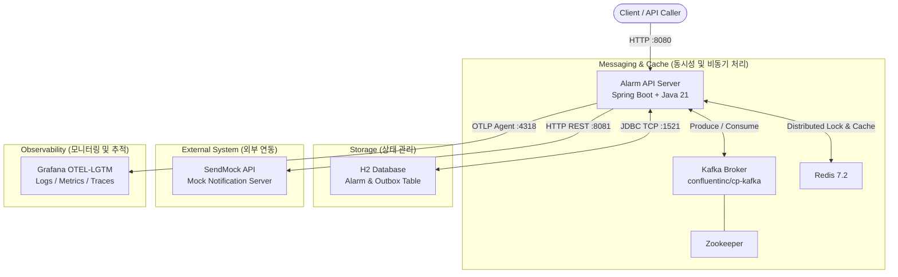
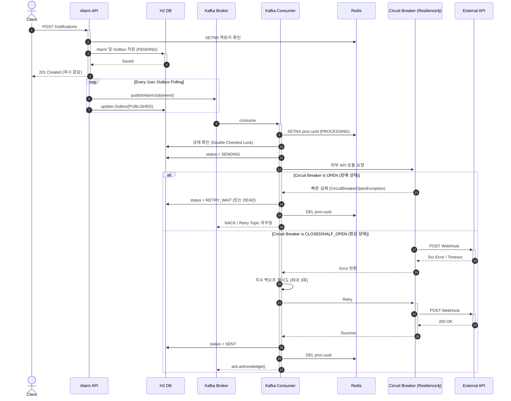

# 알림 발송 시스템 (및 아키텍처 의사결정)

## 🏗️ 시스템 아키텍처 (System Architecture)

현재 `docker-compose.yml` 및 `Dockerfile`을 기반으로 구성된 전체 시스템 아키텍처 다이어그램입니다.



### Kafka 기반 비동기 처리 흐름
- **발행 (Producer)**: 사용자가 `POST /notifications`를 통해 알림 발송을 요청하면, `KafkaAlarmJobProducer`가 `MessageQueuePort`를 통해 알림 이벤트를 Kafka 브로커로 발행합니다.
- **소비 (Consumer)**: `KafkaAlarmJobConsumer`가 Kafka 브로커로부터 이벤트를 비동기적으로 전달받아, 중복 처리를 방지하기 위해 로컬 락 및 데이터베이스 상태 체크를 거쳐 멱등성을 보장하며 `NotificationPort`를 통해 알림을 전송합니다.

---

## 📝 개괄 (Overview)
본 문서는 대규모 트래픽을 처리하는 알람 발송 시스템의 구축 과정, 아키텍처 개선 및 동시성 제어 과정에서 발생한 문제점들과 이를 해결하기 위한 의사결정 내역을 정리한 문서입니다. 멀티 인스턴스 환경에서의 락(Lock) 제어, 메시지 큐(Kafka)를 활용한 비동기 파이프라인, 성능 최적화 및 모니터링 체계 구축 등 다양한 엔지니어링 챌린지와 해결 과정을 담고 있습니다.

## 📌 주요 요구사항
- **기능**: 알림 API, Kafka 연동
  - 알림 신규 생성 및 발송 접수 기능 제공 (Spring Boot API Service, `/notifications` 엔드포인트)
  - 즉시 발송 중심 설계
  - Kafka 기반 비동기 멱등성 제어 및 메시지 큐 연동
  - 외부 Mock API 서버 연동 (`NotificationPort` 및 `MockApiNotificationAdapter` 구현)
  - 동작 검증: 즉시 발송 및 Kafka 비동기 멱등성 연동 검증용 통합 테스트 제공 (`AlarmImmediateTriggerTest.kt`, `AlarmKafkaIntegrationTest.kt`)
- **비기능 (발굴)**:
  - **중복 발송 방지 (멱등성 키)**: 네트워크 재시도나 중복 요청으로 인한 동일 알림의 이중 발송 방지
  - **장애 내구성 (MQ 기반)**: Kafka Broker 및 재시도/DLT(Dead Letter Topic) 구성을 통해 일시적 장애 극복
  - **채널 확장성 (전략 패턴)**: Webhook, Email, SMS 등 다양한 발송 채널 추가에 유연하게 대응할 수 있도록 추상화 인터페이스 구성

---

## 🚀 진행 내용 요약 (Progress Summary)
- **동시성 및 멱등성 제어**: Outbox 폴링 시 데드락 방지를 위한 DB 비관적 락(`FOR UPDATE SKIP LOCKED`) 적용 및 Redis 락과 DB 상태 기반의 DCL(Double-Checked Locking) 구조 확립.
- **아키텍처 고도화**: Kafka 기반 비동기 알람 파이프라인 최적화, WebClient와 `CompletableFuture`를 이용한 Non-blocking 컨슈머 구축, Schedulers.boundedElastic을 이용한 데이터베이스 블로킹 격리.
- **신뢰성 및 추적성 강화**: 메시지 유실 방지를 위한 재시도 백오프 적용, DLQ(Dead Letter Queue) 도입, Snowflake ID와 해시 기반의 단일 PK 성능 최적화, MDC를 활용한 분산 환경 JSON 로깅 도입.

---

## 📖 목차 (Table of Contents)

### 📌 1주차 과제: 기본 아키텍처 및 시스템 설계
**1. 아키텍처 및 시스템 설계**
- [1.1. 코드 아키텍처 선택 (헥사고날 vs 레이어드)](#11-코드-아키텍처-선택-헥사고날-vs-레이어드)
- [1.2. 발송 채널 확장성 패턴 (전략 + 팩토리)](#12-발송-채널-확장성-패턴-전략--팩토리)
- [1.3. 도메인 모델링 방식 (풍부한 도메인 vs 빈약한 도메인)](#13-도메인-모델링-방식-풍부한-도메인-vs-빈약한-도메인)
- [1.4. 객체 생성 방식 (기본 생성자 vs 정적 팩토리 메서드)](#14-객체-생성-방식-기본-생성자-vs-정적-팩토리-메서드)

---

### [📌 2주차 과제: 아키텍처 및 동시성 제어 의사결정](README_2주차과제.md)
**1. 데이터베이스 및 식별자 아키텍처**
- [1.1. PK 최적화: UUIDv7 및 정수형 식별자 도입 (1차)](README_2주차과제.md#11-pk-최적화-uuidv7-및-정수형-식별자-도입-1차)
- [1.2. PK 단일화: Snowflake ID와 해시 기반 멱등성 키 설계 (최종)](README_2주차과제.md#12-pk-단일화-snowflake-id와-해시-기반-멱등성-키-설계-최종)

**2. 동시성 제어 및 멱등성 설계**
- [2.1. Outbox 스케줄러 동시성 제어 (멀티 인스턴스 환경)](README_2주차과제.md#21-outbox-스케줄러-동시성-제어-멀티-인스턴스-환경)
- [2.2. Consumer 멱등성 방어선 구축 (Redis & DB DCL)](README_2주차과제.md#22-consumer-멱등성-방어선-구축-redis--db-dcl)
- [2.3. Producer(API) 멱등성 보장 및 DB 장애 격리](README_2주차과제.md#23-producerapi-멱등성-보장-및-db-장애-격리)

**3. 비동기 메시징 및 성능 최적화**
- [3.1. Kafka 기반 비동기 파이프라인 및 DLQ 구축](README_2주차과제.md#31-kafka-기반-비동기-파이프라인-및-dlq-구축)
- [3.2. Non-blocking 리액티브 파이프라인 도입 (WebClient)](README_2주차과제.md#32-non-blocking-리액티브-파이프라인-도입-webclient)
- [3.3. 동기식 DB 접근(JPA/JDBC)의 블로킹 스레드 격리](README_2주차과제.md#33-동기식-db-접근jpajdbc의-블로킹-스레드-격리)

**4. 데이터 정합성 및 상태 파이프라인**
- [4.1. 알람 전송 생명주기 상태 세분화 (Client -> Kafka -> Redis)](README_2주차과제.md#41-알람-전송-생명주기-상태-세분화-client---kafka---redis)
- [4.2. Outbox 장애 복구를 위한 재시도(Retry) 및 동기화 전략](README_2주차과제.md#42-outbox-장애-복구를-위한-재시도retry-및-동기화-전략)

**5. 운영 및 모니터링 체계**
- [5.1. 분산 환경 추적성을 위한 MDC 및 JSON 로깅 아키텍처](README_2주차과제.md#51-분산-환경-추적성을-위한-mdc-및-json-로깅-아키텍처)
- [5.2. 인프라 및 아키텍처 보완 (Kafka 클러스터링, Rate Limiter 등)](README_2주차과제.md#52-인프라-및-아키텍처-보완-kafka-클러스터링-rate-limiter-등)

---

### [📌 3주차 과제: 대규모 알림 시스템의 커넥션 최적화 및 파티셔닝 아키텍처 의사결정](README_3주차과제.md)
**1. 고성능 통신 및 커넥션 아키텍처**
- [1.1. HTTP 클라이언트(WebClient) 싱글톤 관리 및 커넥션 풀 재사용](README_3주차과제.md#11-http-클라이언트webclient-싱글톤-관리-및-커넥션-풀-재사용)
- [1.2. HTTP 커넥션 풀 명시적 설정 (ConnectionProvider 기본값의 함정)](README_3주차과제.md#12-http-커넥션-풀-명시적-설정-connectionprovider-기본값의-함정)
- [1.3. DB 커넥션 풀(HikariCP) 최적화 — 처리 능력(Throughput) 중심 설계](README_3주차과제.md#13-db-커넥션-풀hikaricp-최적화--처리-능력throughput-중심-설계)
- [1.4. DB 커넥션 풀 vs 톰캣 스레드 풀 정합성 조율](README_3주차과제.md#14-db-커넥션-풀-vs-톰캣-스레드-풀-정합성-조율)
- [1.5. 부하 테스트(Scale-out)에 따른 최종 파라미터 변경 이력](README_3주차과제.md#15-부하-테스트scale-out에-따른-최종-파라미터-변경-이력)

**2. 장애 대응 및 관측성(Observability)**
- [2.1. 타임아웃 4단계 세분화 전략 (HTTP)](README_3주차과제.md#21-타임아웃-4단계-세분화-전략-http)
- [2.2. 커넥션 풀 상태 모니터링 (Metrics + Grafana)](README_3주차과제.md#22-커넥션-풀-상태-모니터링-metrics--grafana)
- [2.3. HTTP 클라이언트 엔진 선택 (Reactor Netty)](README_3주차과제.md#23-http-클라이언트-엔진-선택)
- [2.4. 인프라 지표 및 성능 파악 가이드 (네트워크, 슬로우 쿼리, DB IO)](README_3주차과제.md#24-인프라-지표-및-성능-파악-가이드-네트워크-슬로우-쿼리-db-io)

**3. 대규모 데이터베이스 아키텍처 (파티셔닝 및 최적화)**
- [3.1. Outbox DB 엔진 교체: H2 -> PostgreSQL (SKIP LOCKED 이슈)](README_3주차과제.md#31-outbox-db-엔진-교체-h2---postgresql-skip-locked-이슈)
- [3.2. 알림 내역 조회 API 고도화 및 파티셔닝 전략](README_3주차과제.md#32-알림-내역-조회-api-고도화-및-파티셔닝-전략)
- [3.3. MySQL 파티셔닝 전략 비교 및 아키텍처 의사결정](README_3주차과제.md#33-mysql-파티셔닝-전략-비교-및-아키텍처-의사결정)
- [3.4. 다중 서버 환경에서의 파티션 자동화 (ShedLock)](README_3주차과제.md#34-다중-서버-환경에서의-파티션-자동화-shedlock)
- [3.5. MAU 100만 명 아키텍처를 위한 DB 자료형 최적화](README_3주차과제.md#35-mau-100만-명-아키텍처를-위한-db-자료형-최적화)
- [3.6. 대규모 알림 내역 조회를 위한 커서 기반 페이지네이션 설계](README_3주차과제.md#36-대규모-알림-내역-조회를-위한-커서-기반-페이지네이션-설계)
- [3.7. 100만 MAU 알림 시스템을 위한 인덱스 및 PK 아키텍처 설계](README_3주차과제.md#37-100만-mau-알림-시스템을-위한-인덱스-및-pk-아키텍처-설계)

**4. 부하 테스트 및 서킷 브레이커 설정 종합 리포트**
- [4.1. 개요 및 테스트 환경](README_3주차과제.md#41-개요-및-테스트-환경)
- [4.2. 시나리오별 결과 및 분석 (RANDOM 모드 기반)](README_3주차과제.md#42-시나리오별-결과-및-분석-random-모드-기반)
- [4.3. 개선 파라미터 적용 (현재 반영됨)](README_3주차과제.md#43-개선-파라미터-적용-현재-반영됨)
- [4.4. 튜닝 후 재검증 (500 RPS)](README_3주차과제.md#44-튜닝-후-재검증-500-rps)
- [4.5. 아키텍처 스케일 아웃 (Nginx 로드밸런서 + API 3대 확장) 도입 배경 및 분석](README_3주차과제.md#45-아키텍처-스케일-아웃-nginx-로드밸런서--api-3대-확장-도입-배경-및-분석)
- [4.6. 스케일 아웃(Scale-out) + DB/Nginx 커넥션 튜닝 후 최종 결과 (Aggressive K6 모드)](README_3주차과제.md#46-스케일-아웃scale-out--dbnginx-커넥션-튜닝-후-최종-결과-aggressive-k6-모드)
- [4.7. 스케일 아웃 + CB 튜닝 후 A/B/C 재검증](README_3주차과제.md#47-스케일-아웃--cb-튜닝-후-abc-재검증)
- [4.8. 최종 튜닝 자동화 스크립트 실행 결과](README_3주차과제.md#48-최종-튜닝-자동화-스크립트-실행-결과)

---

---

### 📌 부록: 실행 가이드
**7. 실행 가이드**
- [7.1. 로컬 실행 방법](#71-로컬-실행-방법)

---

## 1. 아키텍처 및 시스템 설계

### 1.1. 코드 아키텍처 선택 (헥사고날 vs 레이어드)

#### ❓ 고민하게 된 구체적 문제 상황
- 알림 발송 특성상 데이터베이스(JPA), 메시지 브로커(Kafka), 캐시/분산락(Redis), 외부 전송 API(Webhooks/SMS/Email) 등 수많은 인프라 연동이 필수적이었습니다.
- 기존 레이어드 구조에서는 비즈니스 로직을 담은 Service 클래스가 이 인프라 라이브러리 객체를 직접 참조하면서 강하게 묶여, 라이브러리 버전업이나 전송 벤더 변경 시 비즈니스 도메인 코드가 요동치는 문제가 발생했습니다.

#### ⚖️ 대안 비교
- **A안**: 전통적인 레이어드 아키텍처
  - *장점*: 구조가 직관적이고 스프링 부트의 기본 정석 구조라 초기 구현 속도가 매우 빠름.
  - *단점*: 비즈니스 로직(Service)이 특정 DB 프레임워크나 외부 기술 의존 모듈에 강하게 결합됨.
- **B안**: 헥사고날 아키텍처 (Ports & Adapters)
  - *장점*: 핵심 도메인을 기술 영역과 완벽히 격리하여 인프라 변경에 유연하게 대응 가능함.
  - *단점*: 보일러플레이트 코드 및 파일 개수가 늘어남.

#### ✅ 결정: B안 (헥사고날 아키텍처)
- 외부 메시지 큐, 캐시/분산락 등 기술 종속성을 도메인과 완벽히 격리하기 위함.

#### ❌ 포기한 것
- 초기 폴더 구조의 단순함 및 초기 개발 생산성.

#### 💻 적용 코드 예시
```kotlin
// [NotificationPort.kt] 도메인이 의존하는 아웃바운드 포트 인터페이스
interface NotificationPort {
    fun sendNotification(items: List<AlarmBatchItem>): Mono<Void>
}

// [MockApiNotificationAdapter.kt] 포트를 구현하는 인프라 어댑터
@Component
class MockApiNotificationAdapter(
    @Value("\${mock.api.url:http://localhost:8081}") private val mockApiUrl: String
) : NotificationPort {
    override fun sendNotification(items: List<AlarmBatchItem>): Mono<Void> { ... }
}
```

### 1.2. 발송 채널 확장성 패턴 (전략 + 팩토리)

#### ❓ 고민하게 된 구체적 문제 상황
- 초기에는 카카오톡만 발송하던 서비스에 SMS, 이메일 등 채널이 추가로 연동되어야 하는 상황이었습니다.
- `if (type == KAKAO)` 형태의 분기문이 무한히 늘어나고, 다른 채널 수정 과정에서 기존 카카오톡 코드까지 실수로 변경해 장애를 일으키는 위험이 발생했습니다.

#### ⚖️ 대안 비교
- **A안**: 단일 발송 서비스 내 분기(if-else) 처리
  - *장점*: 코드가 단일 지점에 모여 단순 흐름을 파악하기 쉬움.
  - *단점*: 채널 추가 시 기존 코드를 변경해야 해 회귀 버그 위험 높음.
- **B안**: 전략 패턴 + 스프링 빈 팩토리 패턴
  - *장점*: 검증된 기존 코드 변경 없이 새 채널 어댑터만 추가하여 확장이 유연함.
  - *단점*: 파일 개수가 늘어남.

#### ✅ 결정: B안 (전략 패턴 + 팩토리 패턴)
- 기존 코드 변경 없이 신규 발송 클래스만 추가하여 유연하게 확장하기 위함.

#### 💻 적용 코드 예시
```kotlin
// [AlarmService.kt] 채널 타입에 상관없이 인터페이스만 호출
notificationPort.sendNotification(listOf(batchItem)).block()

// 신규 채널 추가 시 기존 코드는 건드리지 않고 Adapter만 추가
// @Component class SmsNotificationAdapter : NotificationPort { ... }
```

### 1.3. 도메인 모델링 방식 (풍부한 도메인 vs 빈약한 도메인)

#### ❓ 고민하게 된 구체적 문제 상황
- 알람 생명주기(`PENDING` -> `PROCESSING` -> `DONE`)는 엄격히 준수되어야 하나, 도메인이 빈약할 경우 비즈니스 로직 작성 중 상태 검증을 누락하는 등의 버그가 발생했습니다.

#### ⚖️ 대안 비교
- **A안**: 빈약한 도메인 모델 (Anemic Domain Model)
  - *장점*: 단순 구현이 쉽고 빠름.
  - *단점*: 도메인 규칙이 서비스 곳곳에 분산되어 객체 정합성이 쉽게 무너짐.
- **B안**: 풍부한 도메인 모델 (Rich Domain Model)
  - *장점*: 캡슐화된 메서드를 통해서만 상태 변경을 수행해 비즈니스 규칙 오염을 막음.
  - *단점*: 러닝커브 및 설계 오버헤드 존재.

#### ✅ 결정: B안 (풍부한 도메인 모델)
- 비즈니스 지식이 도메인 외부로 유출되는 것을 차단하기 위함.

#### 💻 적용 코드 예시
```kotlin
// [Alarm.kt] 상태 변경은 반드시 도메인 메서드를 통해서만 가능
fun sent() { status = AlarmStatus.SENT; updatedAt = LocalDateTime.now() }

// [AlarmService.kt]
alarm.sent()         // ✅ 직접 대입 불가 (private constructor)
```

### 1.4. 객체 생성 방식 (기본 생성자 vs 정적 팩토리 메서드)

#### ❓ 고민하게 된 구체적 문제 상황
- 알람 객체의 필수 필드(`senderId` 등)가 빈 문자열 등으로 누락된 채 삽입되는 데이터 정합성 붕괴 상황이 발생했습니다.

#### ⚖️ 대안 비교
- **A안**: 퍼블릭 기본 생성자 직접 호출
- **B안**: 정적 팩토리 메서드 패턴

#### ✅ 결정: B안 (정적 팩토리 메서드 패턴)
- 생성 순간부터 유효성(Validation)을 강제로 보장하기 위함.

#### 💻 적용 코드 예시
```kotlin
class Alarm private constructor( ... ) {
    companion object {
        fun create(senderId: String, name: String, ...): Alarm {
            require(name.isNotBlank()) { "알람 이름은 비어있을 수 없습니다." }
            return Alarm(id, senderId, name, ...)
        }
    }
}
```

---

## 2. 데이터베이스 및 식별자 아키텍처

### 2.1. PK 최적화: UUIDv7 및 정수형 식별자 도입 (1차)

#### ❓ 고민하게 된 구체적 문제 상황
- 기존 레코드 PK로 `UUIDv4`를 사용하면서 데이터베이스에서 무작위 순서 삽입으로 인한 페이지 분할(Page Split)이 심각하게 발생했습니다. 이로 인해 I/O가 늘어나고 전반적인 쓰기 성능이 급감했습니다.

#### ⚖️ 결정 및 적용 내용
- 테이블의 PK를 `BIGINT AUTO_INCREMENT`(`seq`)로 변경하여 순차 삽입 성능 확보.
- 비즈니스 키로 사용되는 외부 노출용 식별자는 시간에 따라 정렬이 가능한 `UUIDv7`로 변경하여 인덱스 단편화를 줄임.

### 2.2. PK 단일화: Snowflake ID와 해시 기반 멱등성 키 설계 (최종)

#### ❓ 고민하게 된 구체적 문제 상황
- DB 성능용 `seq`와 멱등성용 `id`로 식별자가 분리되어 관리되면서, 저장/조회 과정에서 불일치가 발생하는 설계 복잡도가 생겼습니다. 외부 파트너사가 문자열 멱등성 키를 보낼 수 있는 유연성을 확보하면서도 DB 레벨 PK를 `BIGINT`로 일원화할 필요가 있었습니다.

#### ⚖️ 대안 비교
- **A안**: 문자열 UUIDv7을 그대로 기본키(PK)로 사용
  - *단점*: 정수형 인덱스에 비해 디스크 및 탐색 성능 저하 큼.
- **B안**: 64비트 정수 Snowflake ID + 문자열 멱등성 키 정수 해싱

#### ✅ 결정: B안 (Snowflake ID 발급 + 멱등성 키 64비트 정수 해싱)
- 클라이언트가 제공한 `Idempotency-Key` 문자열을 FNV-1a 해시를 통해 64비트 정수로 일관되게 변환하여 `BIGINT` PK 하나로 도메인과 DB 간 복잡성을 없앴습니다.

#### 💻 적용 코드 예시
```kotlin
// 문자열 멱등성 키를 64비트 정수로 일관되게 변환
val parsedId: Long = if (!idempotencyKey.isNullOrBlank()) {
    idempotencyKeyToLong(idempotencyKey)
} else {
    SnowflakeIdGenerator.nextId() // Snowflake ID 생성
}
```

---

## 3. 비동기 메시징 및 성능 최적화

### 3.1. 즉시 발송 아키텍처 설계 (API 접수와 실제 처리의 분리)

#### ❓ 고민하게 된 구체적 문제 상황
- 사용자가 버튼 클릭 시 즉시 접수 완료 응답을 주어야 하지만, 단일 트랜잭션에서 외부 API를 호출하면 백엔드 스레드 풀이 급속히 고갈되었습니다.

#### ⚖️ 대안 비교
- **A안**: API 서버 내부에서 외부 API까지 동기 처리
- **B안**: 요청 접수(API)와 실제 처리(Worker)를 분리하여 메시지 큐(MQ)로 버퍼링

#### ✅ 결정: B안 (접수와 처리 분리)
- 0.1초 내 응답과 함께 실제 부하는 백그라운드 Worker에서 분산 처리.

### 3.2. 메시지 영속성 저장 매체 선택 (Redis vs Kafka)

#### ❓ 고민하게 된 구체적 문제 상황
- 대기열 메시지를 메모리(Redis)에 두었다가 서버 다운 시 발송되지 못한 대규모 알람이 영구 유실되는 문제가 생겼습니다.

#### ✅ 결정: Kafka 도입
- 인메모리 완전 초고속 처리성능을 포기하고, 디스크 커밋 로그 기반 저장소인 Kafka를 통해 장애 복구 시에도 유실을 0%로 만들었습니다.

### 3.3. Kafka 브로커 메시지 유실 및 중복 저장 방지

#### ❓ 고민하게 된 구체적 문제 상황
- 리더 브로커에 장애가 발생하거나 네트워크 지연으로 ACK가 유실될 경우, Kafka 역시 데이터 유실이나 중복 전송이 발생함을 확인했습니다.

#### ✅ 결정: 클러스터 기반 내결함성 설정 적용
- 브로커 3대 클러스터링 기반의 `replication.factor=3` + `min.insync.replicas=2` + `enable.idempotence=true` 적용.

### 3.4. 카프카 비동기 분산 시 핫파티션 회피 파티션 키 설계

#### ❓ 고민하게 된 구체적 문제 상황
- 특정 사용자가 순간적으로 10만 건을 발송할 때, 파티션 키를 `userId`로 하면 핫파티션이 발생하여 일부 인스턴스만 일하고 나머지는 놀게 되었습니다. 반면 `channelId`로 묶으면 특정 채널 오류가 전체를 막았습니다.

#### ✅ 결정: `senderId` + `receiverId` 조합 파티션 키
- 핫파티션을 회피하고 데이터를 골고루 분배하며, 동일 수신자에 대한 순차 처리까지 만족.

### 3.5. Kafka 기반 비동기 파이프라인 및 DLQ 구축

#### ❓ 고민하게 된 구체적 문제 상황
- 특정 에러 메시지가 파티션 맨 앞을 막아버리는 포이즌 필(Poison Pill) 현상이 발생.

#### ✅ 결정: Non-blocking Retry와 DLQ (Dead Letter Queue) 도입
- Spring Kafka의 `RetryTopicConfiguration`을 사용하여 실패 메시지를 재시도 토픽(`alarm-jobs-retry`)으로 이동시키고, 최대 횟수 초과 시 수동 개입을 위한 DLT 토픽으로 자동 라우팅되도록 구축했습니다.

### 3.6. Non-blocking 리액티브 파이프라인 도입 (WebClient)

#### ❓ 고민하게 된 구체적 문제 상황
- 동기식(`RestTemplate`) 통신으로 인해 외부 API 응답 지연 시, 컨슈머 스레드 전체가 블로킹되며 TPS가 극도로 떨어졌습니다.

#### ⚖️ 대안 비교
- **A안**: 동기식 블로킹 컨슈머 유지 및 스레드 풀 수백 개 확장
- **B안**: WebClient 기반 완전한 Non-blocking 비동기 파이프라인 전환

#### ✅ 결정: B안 (비동기 리액티브 파이프라인 도입)
- 최소한의 스레드로 대규모 동시 발송 성능을 이끌어내며 HTTP Status 기반의 지능적 에러 핸들링 분기(4xx, 5xx) 적용.

#### 💻 적용 코드 예시
```kotlin
// 외부 전송 (Non-blocking) -> 성공/실패 시 후속 작업 정의 (onErrorResume)
notificationPort.sendNotification(payload.toDomain())
    .onErrorResume { e ->
        if (e.statusCode.is4xxClientError) Mono.empty() else Mono.error(e)
    }.toFuture() // CompletableFuture로 변환
```

### 3.7. 동기식 DB 접근(JPA/JDBC)의 블로킹 스레드 격리

#### ❓ 고민하게 된 구체적 문제 상황
- WebClient의 리액티브 논블로킹 엔진에서 DB(JPA) 통신 시 블로킹 작업이 일어나면 전체 이벤트 루프가 멈추는(Starvation) 심각한 장애가 발생합니다.

#### ✅ 결정: Schedulers.boundedElastic() 기반 스레드 격리
- R2DBC 전면 전환이라는 막대한 비용 대신, 리액티브 체인 상에서 DB 저장 구간에만 `.publishOn(Schedulers.boundedElastic())`을 결합해 블로킹 작업만 별도 풀에서 안전하게 돌도록 타협.

### 3.8. 외부 연동 API 서버 보호를 위한 전송 빈도 조율 (Rate Limiting)

#### ❓ 고민하게 된 구체적 문제 상황
- 외부 통신사 API 한도 초과(HTTP 429 에러)로 전송이 일괄 차단되는 이슈 발생.

#### ✅ 결정: Kafka Batch Listener + Redis Bucket4j
- Lua 스크립트를 적용한 원자적 Redis 토큰 버킷으로, 클러스터 레벨에서 초당 전송 제한(예: 500회)을 준수하도록 동적으로 속도를 제어함.

---

## 4. 동시성 제어 및 멱등성 설계

### 4.1. 클라이언트 중복 요청 방지 검증 기술 (Redis vs RDB)

#### ❓ 고민하게 된 구체적 문제 상황
- 클라이언트의 연속 클릭 및 네트워크 재시도로 동일 요청이 폭주. RDB의 Unique 제약으로 막으려 하자 DB 커넥션 병목이 발생했습니다.

#### ✅ 결정: Redis `setIfAbsent` 멱등 검사
- 메모리에서 빠르게 차단하여 부하를 분산하고 DB 서버를 완전히 보호했습니다.

### 4.2. Producer(API) 멱등성 보장 및 DB 장애 격리

#### ❓ 고민하게 된 구체적 문제 상황
- Redis 락을 5분간 선점한 뒤 만약 DB 자체 에러로 롤백이 일어나면, 5분 동안 재시도가 불가능해지는 버그가 생겼습니다.

#### ✅ 결정: Redis 락 보상 트랜잭션 (`catch` 에서 해제) + 기존 정보 반환
- DB 저장 실패 시 `catch` 블록에서 Redis 키를 바로 지워 재시도를 허용하고, 이미 저장되어 있는 락 충돌의 경우 기존 알람을 조회해 200 OK로 반환.

### 4.3. 동시성 및 중복 제어 엔진 선택 (Redis 분산 락 vs Kafka 큐)

#### ❓ 고민하게 된 구체적 문제 상황
- 다수의 컨슈머 워커들이 중복 이벤트를 분산 락으로 막으려 할 때 외부 통신 지연 때문에 대량의 대기가 발생했습니다.

#### ✅ 결정: Kafka 파티션 키 기반 순차 제어 결합
- 메시지를 파티션에 단일 큐 형태로 줄 세워 원천적으로 동시 경합 필요성을 없애고 락 대기 부하를 방지했습니다.

### 4.4. 공통 자원 제어 패턴 (AOP 프록시 vs 템플릿/콜백)

#### ❓ 고민하게 된 구체적 문제 상황
- `@DistributedLock` 등의 어노테이션 사용 시, Spring AOP 프록시의 Self-Invocation 제약으로 인해 분산 락이 제대로 걸리지 않고 누수되는 문제.

#### ✅ 결정: 템플릿/콜백 패턴 (LockTemplate)
- 함수 호출 람다(Lambda)로 락 획득/반납 경계를 명확히 분리하여 컴파일러 수준에서 안전성을 통제했습니다.

### 4.5. 카프카 최소 1회 전송에 따른 중복 소비 극복 전략

#### ❓ 고민하게 된 구체적 문제 상황
- 카프카의 At-least-once 보장으로 인해, 외부 발송은 마쳤으나 ACK 응답 전 컨슈머가 죽으면 중복 발송이 발생합니다.

#### ✅ 결정: Redis `SETNX` 기반 진행(PROCESSING) 선점
- 다른 컨슈머가 동일 메시지를 할당받아도, Redis에 `PROCESSING`이나 `DONE` 플래그가 있으면 발송 자체를 스킵하도록 설정.

### 4.6. Consumer 멱등성 방어선 구축 (Redis & DB DCL)

#### ❓ 고민하게 된 구체적 문제 상황
- Redis TTL이 만료된 먼 과거의 중복 메시지가 카프카 재전달로 들어오면 막지 못합니다.

#### ✅ 결정: DCL (Double-Checked Locking) 도입
- 1차 검증(DB), 단기 방어(Redis 락), 2차 재검증(DB)의 3중 방어막을 구축해 모든 유형의 메시지 유실과 중복을 원천 차단했습니다.

### 4.7. Outbox 스케줄러 동시성 제어 (멀티 인스턴스 환경)

#### ❓ 고민하게 된 구체적 문제 상황
- 멀티 서버 환경에서 여러 인스턴스의 스케줄러가 동시에 미발행 알림을 폴링할 때 Race Condition 발생.

#### ⚖️ 대안 비교
- **A안**: 애플리케이션 레벨 독점 락 (ShedLock 등) - 단일 처리 병목 발생.
- **B안**: DB 비관적 락 병렬 처리 (`FOR UPDATE SKIP LOCKED`)

#### ✅ 결정: B안 (`FOR UPDATE SKIP LOCKED`)
- 이미 선점된 레코드는 건너뛰고 다음 데이터를 처리하여 데드락 없이 최대 병렬 성능을 확보했습니다.

#### 💻 적용 쿼리 예시
```sql
SELECT * FROM alarm_outbox_events 
WHERE status = 'PENDING' FOR UPDATE SKIP LOCKED;
```

---

## 5. 데이터 정합성 및 상태 파이프라인

### 5.1. 알람 전송 생명주기 상태 세분화 (Client -> Kafka -> Redis)

#### ❓ 고민하게 된 구체적 문제 상황
- `PENDING` -> `DONE` 이라는 2단계 상태로는 카프카 전송 오류인지 컨슈머 외부 API 오류인지 분간할 수 없어 재처리 지점을 파악하기 불가능했습니다.

#### ✅ 결정: 파이프라인 구간별 상태 극대화 세분화
- 대기(`PENDING`), 카프카 적재(`PUBLISHED`), 발송 시작(`SENDING`), 최종 성공(`SENT`), 일시 실패(`FAILED`), 영구 실패(`DEAD`)로 나누어 모니터링 가시성을 획득.

### 5.2. 알람 저장과 Kafka 발행의 원자성 보장 (Outbox Pattern)

#### ❓ 고민하게 된 구체적 문제 상황
- API 트랜잭션 도중 Kafka 발행 실패 시 DB만 저장되고 메시지는 유실되는 불일치.

#### ✅ 결정: Outbox Pattern 도입
- API 단에서는 알림 정보와 함께 `OutboxEvent` 테이블에 내역을 저장하는 것으로 트랜잭션을 마감하고, 별도의 스케줄러가 카프카 발행 책임을 위임받아 무조건적인 원자성 보장.

### 5.3. Outbox 장애 복구를 위한 재시도(Retry) 및 동기화 전략

#### ❓ 고민하게 된 구체적 문제 상황
- 카프카 장애 시 Outbox 스케줄러가 무한 재시도를 하여 서버가 과부하 걸리거나, 원본 `Alarm` 데이터와의 상태 불일치가 발생.

#### ✅ 결정: 백오프 재시도 및 상태 동기화
- 백오프 시간(`5초 -> 10초 -> 20초`)을 늘려가며 최대 시도 후 `PUBLISH_FAILED` 처리하고 `Alarm` 엔티티 상태와 실시간으로 동기화함.

### 5.4. 외부 에러(429/5xx) 복구 및 사후 실패 처리

#### ❓ 고민하게 된 구체적 문제 상황
- 외부 통신사의 일시적 지연으로 대량 메시지가 즉시 실패 처리되며 유실됨.

#### ✅ 결정: WebClient 자체 지수 백오프 및 재시도 토픽 라우팅
- 1초 -> 2초 -> 4초로 `Retry.backoff` 적용 및 최종 실패 시 카프카 Retry 큐로 넘겨 1분 후 재소비시킴.

---

## 6. 운영 및 모니터링 체계

### 6.1. 분산 환경 추적성을 위한 MDC 및 JSON 로깅 아키텍처

#### ❓ 고민하게 된 구체적 문제 상황
- 멀티 인스턴스와 비동기 Kafka 환경에서 특정 클라이언트의 단일 알림 파이프라인을 온전히 추적하기 불가능.

#### ✅ 결정: MDC 분산 전파 및 JSON 로깅(LogstashEncoder) 도입
- 요청 진입점에서 UUIDv7 기반의 `requestId`를 생성해 MDC에 담고, Kafka Interceptor를 통해 파이프라인 끝까지 헤더로 전달. 모든 로그는 JSON 포맷으로 생성하여 ELK 등 시스템의 검색 및 파싱을 용이하게 구성함.

### 6.2. 시퀀스 다이어그램 요약

#### 알림 접수부터 전송까지의 성공/재시도/서킷 브레이커 흐름


### 6.3. 서킷 브레이커(Circuit Breaker) 도입 완료
- **빠른 실패(Fail Fast) 및 자원 보호**: 외부 API 서비스의 장애 지속 시 계속된 타임아웃 대기로 인한 커넥션 스레드 고갈을 막기 위해 Resilience4j 서킷 브레이커를 도입했습니다.
- **Fail-Fast 처리**: 서킷 브레이커가 OPEN 상태일 때는 외부 API를 호출하지 않고 즉시 `CircuitBreakerOpenException`을 발생시켜 불필요한 네트워크 대기 시간을 줄이고 빠른 처리를 유도합니다.

---

## 7. 실행 가이드

### 7.1. 로컬 실행 방법
Zookeeper 및 Kafka 환경을 Docker Compose를 활용해 기동한 후 애플리케이션을 테스트할 수 있습니다.

1. **Kafka 컨테이너 실행**:
   프로젝트 루트 경로에서 아래 명령을 통해 백그라운드로 Kafka 브로커를 띄웁니다.
   ```bash
   # 기존 이미지로 실행
   docker-compose up -d
   
   # 새로운 이미지로 빌드 후 실행
   docker-compose up -d --build alarm-api
   ```
2. **애플리케이션 실행**:
   ```bash
   ./gradlew bootRun
   ```
3. **전체 통합 테스트 실행**:
   ```bash
   ./gradlew test
   ```

### 7.2. 성능 테스트 환경 (perf) 실행 방법
성능 테스트 환경을 위한 별도의 도커 컴포즈 파일(`docker-compose-perf.yml`)을 사용하여 전체 시스템(API, Kafka, Redis, 모니터링 등)을 실행하고 관리하는 방법입니다.

1. **기존 컨테이너 및 볼륨 초기화 (삭제)**:
   기존 컨테이너와 연결된 데이터 볼륨까지 깔끔하게 지웁니다.
   ```bash
   docker compose -f docker-compose-perf.yml down -v
   ```

2. **새로 빌드하고 백그라운드에서 실행**:
   이미지를 새로 빌드하고(`--build`) 백그라운드(`-d`)에서 컨테이너를 띄웁니다.
   ```bash
   docker compose -f docker-compose-perf.yml up --build -d
   ```