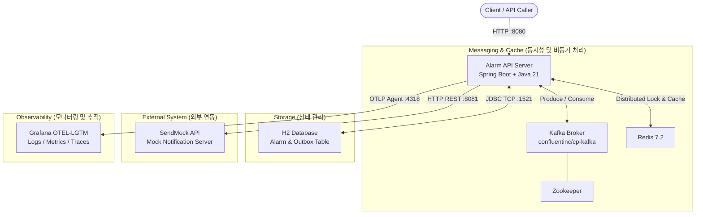

# 2주차 과제 - 아키텍처 및 동시성 제어 의사결정

## 🏗️ 시스템 아키텍처 (System Architecture)

현재 `docker-compose.yml` 및 `Dockerfile`을 기반으로 구성된 전체 시스템 아키텍처 다이어그램입니다.



## 📝 개괄 (Overview)
본 문서는 대규모 트래픽을 처리하는 알람 발송 시스템의 아키텍처 개선 및 동시성 제어 과정에서 발생한 문제점들과 이를 해결하기 위한 의사결정 내역을 정리한 문서입니다. 멀티 인스턴스 환경에서의 락(Lock) 제어, 메시지 큐(Kafka)를 활용한 비동기 파이프라인, 성능 최적화 및 모니터링 체계 구축 등 다양한 엔지니어링 챌린지와 해결 과정을 담고 있습니다.

## 📖 목차 (Table of Contents)

**1. 데이터베이스 및 식별자 아키텍처**
- [1.1. PK 최적화: UUIDv7 및 정수형 식별자 도입 (1차)](#11-pk-최적화-uuidv7-및-정수형-식별자-도입-1차)
- [1.2. PK 단일화: Snowflake ID와 해시 기반 멱등성 키 설계 (최종)](#12-pk-단일화-snowflake-id와-해시-기반-멱등성-키-설계-최종)

**2. 동시성 제어 및 멱등성 설계**
- [2.1. Outbox 스케줄러 동시성 제어 (멀티 인스턴스 환경)](#21-outbox-스케줄러-동시성-제어-멀티-인스턴스-환경)
- [2.2. Consumer 멱등성 방어선 구축 (Redis & DB DCL)](#22-consumer-멱등성-방어선-구축-redis--db-dcl)
- [2.3. Producer(API) 멱등성 보장 및 DB 장애 격리](#23-producerapi-멱등성-보장-및-db-장애-격리)

**3. 비동기 메시징 및 성능 최적화**
- [3.1. Kafka 기반 비동기 파이프라인 및 DLQ 구축](#31-kafka-기반-비동기-파이프라인-및-dlq-구축)
- [3.2. Non-blocking 리액티브 파이프라인 도입 (WebClient)](#32-non-blocking-리액티브-파이프라인-도입-webclient)
- [3.3. 동기식 DB 접근(JPA/JDBC)의 블로킹 스레드 격리](#33-동기식-db-접근jpajdbc의-블로킹-스레드-격리)

**4. 데이터 정합성 및 상태 파이프라인**
- [4.1. 알람 전송 생명주기 상태 세분화 (Client -> Kafka -> Redis)](#41-알람-전송-생명주기-상태-세분화-client---kafka---redis)
- [4.2. Outbox 장애 복구를 위한 재시도(Retry) 및 동기화 전략](#42-outbox-장애-복구를-위한-재시도retry-및-동기화-전략)

**5. 운영 및 모니터링 체계**
- [5.1. 분산 환경 추적성을 위한 MDC 및 JSON 로깅 아키텍처](#51-분산-환경-추적성을-위한-mdc-및-json-로깅-아키텍처)
- [5.2. 인프라 및 아키텍처 보완 (Kafka 클러스터링, Rate Limiter 등)](#52-인프라-및-아키텍처-보완-kafka-클러스터링-rate-limiter-등)

## 🚀 진행 내용 요약 (Progress Summary)
- **동시성 및 멱등성 제어**: Outbox 폴링 시 데드락 방지를 위한 DB 비관적 락(`FOR UPDATE SKIP LOCKED`) 적용 및 Redis 락과 DB 상태 기반의 DCL(Double-Checked Locking) 구조 확립.
- **아키텍처 고도화**: Kafka 기반 비동기 알람 파이프라인 최적화, WebClient와 `CompletableFuture`를 이용한 Non-blocking 컨슈머 구축, Schedulers.boundedElastic을 이용한 데이터베이스 블로킹 격리.
- **신뢰성 및 추적성 강화**: 메시지 유실 방지를 위한 재시도 백오프 적용, DLQ(Dead Letter Queue) 도입, Snowflake ID와 해시 기반의 단일 PK 성능 최적화, MDC를 활용한 분산 환경 JSON 로깅 도입.

---

## 2.1. Outbox 스케줄러 동시성 제어 (멀티 인스턴스 환경)

#### ❓ 고민하게 된 구체적 문제 상황
- **Outbox Pattern 도입**: PENDING 상태 이벤트를 1초마다 읽어 Kafka로 발행하는 스케줄러 구현
- **이슈 발생 (멀티 인스턴스)**: 서버 스케일 아웃 시 여러 인스턴스가 동일한 PENDING 레코드를 동시에 조회
- **결과**: 동일 알람이 Kafka에 다중 적재되는 **중복 발행(Race Condition) 위험** 노출
- **해결 요구사항**: 
  - 동시성 제어(Lock) 필수 적용
  - 메시지 순서 보장은 불필요
  - 데드락(Deadlock) 절대 회피
  - 다중 서버 환경의 자원을 효율적으로 활용한 빠른 처리(병렬성) 보장

---

#### ⚖️ 대안 비교

**A안: 애플리케이션 레벨의 독점 락 (ShedLock, Redis 분산 락 등)**
- **동작 방식**: 락을 선점한 단 1대의 인스턴스만 Outbox 테이블을 혼자서 처리
- **장점**: 
  - 코드가 매우 직관적이고 구현이 단순함
  - DB 레벨의 물리적 락 경합이 전혀 발생하지 않음
- **단점**: 
  - 나머지 서버들은 대기(유휴 상태)하므로 **스케일 아웃 효과 상실**
  - 대량 트래픽 상황에서 단일 처리로 인한 **심각한 성능 병목 우려**

**B안: DB 비관적 락을 활용한 병렬 처리 (`FOR UPDATE SKIP LOCKED`)**
- **동작 방식**: 여러 서버가 동시 접근할 때, 이미 락이 걸린 행(Row)은 기다리지 않고 과감히 건너뜀(Skip)
- **장점**: 
  - 대기 시간이 없어 **데드락(Deadlock)이 원천 차단됨**
  - 여러 인스턴스가 큐에 남은 데이터를 나눠서 **동시에 병렬 처리하므로 압도적으로 속도가 빠름**
- **단점**: 
  - 데이터베이스 벤더 스펙(MySQL 8.0+, PostgreSQL, H2 2.x 등)에 의존적임
  - 단순 독점 락 대비 쿼리 작성이 다소 까다로움

---

#### ✅ 결정: B안 (`FOR UPDATE SKIP LOCKED` 기반 비관적 락 병렬 처리)
- **선택 사유**: 
  - 다중 서버 환경에서 락 대기로 인한 유휴 자원 낭비를 최소화하기 위함
  - 순서 보장보다 **성능과 처리량이 더 중요한 알람 시스템의 특성**을 고려하여, 데드락 위험 없이 병렬 처리량을 극대화할 수 있기 때문임

#### ❌ 포기한 것
- ShedLock 등 스케줄러 단일 실행을 보장하는 라이브러리 기반의 단순하고 빠른 구현 방식

---

#### 💻 적용 쿼리 예시
```sql
-- 다른 인스턴스가 이미 락을 잡은 PENDING 레코드는 대기하지 않고 즉시 SKIP
-- 락이 걸리지 않은 다음 레코드들을 선점하여 곧바로 병렬 발행 처리 진행
SELECT * FROM alarm_outbox_events 
WHERE status = 'PENDING' 
FOR UPDATE SKIP LOCKED;
```

<br>

## 4.2. Outbox 장애 복구를 위한 재시도(Retry) 및 동기화 전략

#### ❓ 고민하게 된 구체적 문제 상황
- **Outbox 발행 실패**: Kafka 브로커 일시 장애나 네트워크 단절 시, Outbox 이벤트 발행이 실패하게 됨.
- **상태 불일치 문제**: 발행 실패 시 Outbox 상태를 즉시 `FAILED`로 변경하면 스케줄러가 다시 처리하지 않아 메시지가 유실됨. 반면 무한 재시도를 하면 서버 리소스 낭비 및 에러 로그 폭주 우려.
- **원본 알람 상태의 괴리**: Outbox 발행이 실패해도 클라이언트가 조회하는 원본 `Alarm` 엔티티는 여전히 `PENDING`으로 남아 있어, 실제로는 카프카 전송조차 실패한 것인지 구분이 불가능함.

---

#### ⚖️ 대안 비교

**A안: 실패 시 상태를 PENDING으로 유지 (무한 재시도)**
- **특징**: 에러만 로깅하고 아무 상태도 변경하지 않음. 다음 스케줄러가 1초 뒤에 또 가져가서 재시도함.
- **장점**: 구현이 가장 심플하며, 브로커 복구 즉시 알아서 전량 재발송됨.
- **단점**: 장애 지속 시 1초마다 모든 인스턴스가 쏟아내는 에러 로그로 시스템이 마비될 수 있음.

**B안: 최대 재시도 횟수(Max Retry) + 지수 백오프(Exponential Backoff)**
- **특징**: `retry_count`와 `next_retry_at` 컬럼을 도입. 
- **장점**: 
  - 재시도 간격을 점진적으로 늘려(5초 ➡️ 10초 ➡️ 20초) 단기 장애 시엔 빠르게 복구하고, 장기 장애 시엔 시스템 리소스 소모를 방어함.
  - 최대 횟수 초과 시 최종 실패(`PUBLISH_FAILED`) 처리하여 데드 레터 큐(DLQ) 형태로 보관 및 수동 처리 가능.
- **단점**: 엔티티와 테이블 스키마에 필드 추가가 필요함.

---

#### ✅ 결정: B안 (지수 백오프 기반의 제한적 재시도 + 원본 상태 동기화)
- **선택 사유**:
  - 알람 시스템의 안정성을 지키면서 불필요한 시스템 리소스 낭비를 막기 위해 채택함.
  - 카프카 장애의 경우 1분 내외로 복구되는 일시적 네트워크 순단이 많으므로, 짧은 백오프(5s, 10s, 20s)로 재시도하여 빠른 복구 도모.
- **추가 결정 사항 (상태 동기화)**:
  - 원본 알람(`Alarm`) 데이터에도 `PUBLISHED`, `PUBLISH_FAILED` 상태를 추가함.
  - 스케줄러가 카프카 발행 성공 시 원본 상태를 `PUBLISHED`로, 최종 3회 실패 시 `PUBLISH_FAILED`로 업데이트하여 클라이언트 측에서 명확한 진행/실패 상태를 인지할 수 있도록 설계함.

#### ❌ 포기한 것
- 장애 상황에 대한 대비 없이 무작정 `PENDING`으로 두고 1초마다 무한히 재시도하는 비효율적 방식.

---

#### 💻 적용 코드 예시 (핵심 요약)
```kotlin
// 1. 지수 백오프 재시도 시간 계산 (5초 ➡️ 10초 ➡️ 20초 대기)
val backoffSeconds = 5L * (1L shl (retryCount - 1)) 
nextRetryAt = LocalDateTime.now().plusSeconds(backoffSeconds)

// 2. 카프카 발행 결과에 따른 원본 알람 상태 동기화
if (publishSuccess) {
    alarmRepository.updateStatusesInBatch(alarmId, AlarmStatus.PUBLISHED)
} else if (retryCount > 3) {
    alarmRepository.updateStatusesInBatch(alarmId, AlarmStatus.PUBLISH_FAILED)
}
```

<br>

## 4.1. 알람 전송 생명주기 상태 세분화 (Client -> Kafka -> Redis)

#### ❓ 고민하게 된 구체적 문제 상황
- **추적 불가 및 상태 파편화**: 클라이언트의 요청이 DB에 저장된 후, Kafka를 거쳐 Redis 분산 락 및 외부 API로 전달되는 복잡한 비동기 전송 과정에서 특정 메시지가 어느 구간에서 실패했는지 추적하기 어려웠습니다.
- **단순한 상태값의 한계**: 기존에는 대기 중(`PENDING`) 혹은 완료(`DONE`) 등 최소한의 상태만 존재하여, 장애 발생 시 카프카 브로커 장애인지, 컨슈머 측 예외인지 구분할 수 없었습니다.
- **재처리 판단 기준 부재**: 상태가 세분화되어 있지 않아, 장애 복구 시 어떤 메시지를 어디서부터 다시 보내야 하는지 정확한 기준을 잡을 수 없어 중복 발송이나 메시지 유실의 위험이 컸습니다.

---

#### ⚖️ 대안 비교

**A안: 최소한의 상태(대기/성공/실패)만 유지**
- **장점**: 상태 전이에 따른 DB 업데이트(I/O)가 적어 시스템 성능에 미치는 영향이 작고 도메인이 단순함.
- **단점**: 분산 시스템 환경에서 장애 발생 지점을 특정할 수 없어 운영 및 트러블슈팅이 사실상 불가능함.

**B안: 파이프라인 단계별 상태 세분화 (선택)**
- **특징**: `PENDING`(대기) ➡️ `PUBLISHED`(카프카 전송 성공) / `PUBLISH_FAILED`(카프카 전송 실패) ➡️ `SENDING`(컨슈머 처리 중/Redis 락 획득) ➡️ `SENT`(최종 성공) / `FAILED`(일시 실패) / `DEAD`(최종 실패) 등으로 상태를 극대화하여 나눔.
- **장점**: 각 메시지의 현재 위치와 성공/실패 여부를 DB에서 한눈에 파악 가능.
- **단점**: 잦은 상태 업데이트 쿼리로 인해 DB 부하가 증가함.

---

#### ✅ 결정: B안 (파이프라인 단계별 상태 세분화 및 RDB 중앙 관리)
- **선택 사유**:
  - 알람 시스템의 특성상 발송 누락이나 중복 발송에 대한 고객 CS 인입 시, **정확한 원인 파악과 후속 조치(수동 재처리 등)가 최우선**이기 때문입니다.
  - 구간별로 상태를 명확히 해야만, 카프카 발행 재시도인지 컨슈머 로직 재시도인지 시스템이 스스로 판단하여 멱등성 있게 처리할 수 있습니다.

#### 📊 세분화된 상태 전이 파이프라인
```mermaid
graph TD
    A([Client 요청]) -->|DB 초기 저장| P[PENDING]
    
    subgraph Producer [Kafka 발행 구간]
        P -->|발행 성공| PB[PUBLISHED]
        P -->|발행 실패| PF[PUBLISH_FAILED]
    end
    
    subgraph Consumer [Redis 락 & API 연동 구간]
        PB -->|처리 시작| SD[SENDING]
        
        SD -->|전송 성공| ST[SENT]
        SD -->|일시 실패/타임아웃| F[FAILED]
        
        F -.->|재시도 (Retry Topic)| SD
        F -->|최대 재시도 초과| D[DEAD]
    end
```

#### 🎯 왜 꼭 상태를 더 세분화해야만 했는가?
비동기 분산 환경에서는 메시지가 카프카로 아예 넘어가지도 못한 것인지(`PUBLISH_FAILED`), 카프카에는 안전하게 적재되었으나 컨슈머가 외부 API를 호출하다가 타임아웃이 난 것인지(`FAILED`), 혹은 모든 재시도 횟수를 소진하여 포기해야 하는 상태인지(`DEAD`)를 엄격히 구분해야만 데드 레터 큐(DLQ) 운영과 명확한 보상 트랜잭션 수행이 가능하기 때문입니다.

#### 🎁 추가한 결과 (얻은 것)
- **가시성 확보 및 운영 대응력 극대화**: 장애 발생 시 어느 파이프라인(Kafka 구간 vs API 연동 구간)에서 멈췄는지 DB만 보고도 즉시 식별 가능.
- **안전한 멱등성 보장**: 각 처리 구간에서 DB 상태를 먼저 확인(Double-Checked)함으로써 중복 처리를 완벽하게 차단할 수 있는 기반 마련.

#### ❌ 포기한 것 (단점)
- 상태가 바뀔 때마다 DB 트랜잭션(UPDATE)이 발생하여 전체 시스템의 **DB I/O 오버헤드와 부하가 증가**함.
- 도메인 엔티티의 라이프사이클과 서비스 비즈니스 로직의 복잡도가 크게 상승함.

<br>

## 2.2. Consumer 멱등성 방어선 구축 (Redis & DB DCL)

#### ❓ 고민하게 된 구체적 문제 상황
- **기존 구조의 한계**: 기존 컨슈머는 중복 판단을 오직 Redis의 `proc:` 키(TTL 3분)에만 의존했으며, DB의 알람 상태는 조회하지 않았습니다.
- **유실 시나리오**:
  1. 컨슈머가 `PROCESSING` 선점 후 외부 API 호출 전에 크래시됨 (ack 전)
  2. 카프카가 장애 복구를 위해 똑같은 메시지를 재전달함
  3. 하지만 3분이 지나지 않아 Redis엔 여전히 `PROCESSING` 키가 살아있어 중복으로 오판하고 스킵함
  4. 스킵된 채 `ack.acknowledge()`가 호출되어, 메시지는 발송되지 않고 영원히 증발함
- **중복 시나리오**:
  - 발송 성공 기록(`SENT`)이 DB에만 저장되고 컨슈머는 이를 참조하지 않음.
  - 3분이 지나 Redis 키가 사라진 뒤 카프카에서 예전 메시지가 재전달되면, 멱등성을 방어할 수단이 없어 그대로 중복 발송됨.

---

#### ⚖️ 대안 비교 및 결정

**✅ 결정: DB를 Source of Truth로 활용하는 DCL(Double-Checked Locking) 구조 도입**

- **1차 검증 (DB)**: 수신한 배치 데이터의 상태를 DB에서 대량 조회 후, 이미 `SENT`, `FAILED`, `DEAD`인 건은 필터링하여 Redis 락 경합조차 하지 않음.
- **분산 락 (Redis)**: 남은 대상들만 Redis `setIfAbsent`를 통해 찰나의 동시성(Race Condition)을 방어.
- **2차 검증 (DB)**: 락을 획득한 이후 DB 상태를 다시 한번 조회하여, 락 대기 중 다른 인스턴스가 처리해버린 건을 차단.
- **상태 전이(SENDING) 및 안전한 Lock 해제**: 검증을 통과한 건만 `SENDING`으로 상태 전이 후 API를 호출하고, 예외 발생 여부와 무관하게 `finally` 블록에서 Redis 락을 해제. 모든 DB 반영이 끝난 뒤에만 오프셋 커밋(Ack) 수행.

#### 💡 결과 및 기대 효과
- **완벽한 중복 차단**: 수 밀리초 내의 동시 요청은 Redis가 튕겨내고, 장기적인 오프셋 재전달은 DB가 튕겨내는 2중 방어선 구축.
- **완벽한 유실 차단**: API 호출 전 크래시가 나더라도, `finally`에서 락이 해제되거나 TTL 만료 후 다음 재전달 시 DB 상태가 여전히 `PUBLISHED`이므로 정상적으로 재처리됨.
- **명확한 에러 라우팅**: HTTP 400 계열은 즉시 `FAILED`로, 500 계열/Timeout은 `RETRY` 토픽으로 재발행하며, 재시도 초과 시 `DEAD` 상태로 분류하여 운영 대응력을 극대화함.

---

#### 💻 적용 코드 예시 (핵심 요약)
```kotlin
// 1. 1차 DB 상태 검증 (SENT, FAILED, DEAD는 무시)
val initialAlarms = alarmRepository.findAllByIds(alarmIds)
val validPayloads = payloads.filter { isValidStatus(initialAlarms[it.alarmId]) }

// 2. Redis 분산 락 획득 시도 (단기 동시성 방어)
for (payload in validPayloads) {
    if (redisTemplate.setIfAbsent("proc:${payload.uuid}", "PROCESSING", 3분) == true) {
        lockedPayloads.add(payload)
    }
}

try {
    // 3. 2차 DB 상태 검증 (Double-Checked Locking)
    val finalAlarms = alarmRepository.findAllByIds(lockedAlarmIds)
    val finalPayloads = lockedPayloads.filter { isValidStatus(finalAlarms[it.alarmId]) }
    
    // 4. 상태 전이(SENDING) 및 API 대량 호출
    alarmRepository.updateStatusesInBatch(finalIds, AlarmStatus.SENDING)
    notificationPort.sendNotification(batchItems)
    
    // 5. 발송 결과 저장 및 에러 라우팅 (SENT, FAILED, RETRY, DEAD)
    alarmRepository.updateStatusesInBatch(successfulIds, AlarmStatus.SENT)
    
} finally {
    // 6. 예외 발생 여부와 무관하게 무조건 Redis 락 해제 및 Offset 커밋
    redisTemplate.delete(lockKeys)
    ack.acknowledge()
}
```

<br>

## 2.3. Producer(API) 멱등성 보장 및 DB 장애 격리

#### ❓ 고민하게 된 구체적 문제 상황
- **캐시와 DB의 라이프사이클 불일치**: `createAlarm` API에서 중복 요청을 방어하기 위해 Redis의 `setIfAbsent`를 이용해 5분짜리 락(Idempotency Key)을 잡고 DB에 알람과 Outbox를 저장함.
- **장애 시나리오 (재시도 불가 문제)**:
  - Redis 락을 잡은 직후, DB 커넥션 풀 고갈이나 데드락 등의 이유로 DB 저장이 실패함.
  - 트랜잭션이 롤백되고 클라이언트에게 500 에러가 반환됨.
  - 클라이언트가 즉시 재시도를 하지만, Redis에는 여전히 5분짜리 락이 남아있어 `409 Conflict` 에러를 뱉음.
  - 결국 **DB 문제로 실패한 요청은 5분 동안 절대 재처리가 불가능해지는 치명적 버그** 발생.

---

#### ⚖️ 대안 비교 및 결정

**A안: DB의 Unique Index 제약 조건을 Source of Truth로 활용**
- **방식**: Redis를 쓰지 않고(혹은 방어용으로만 쓰고), DB의 `(sender_id, uuid)`에 유니크 키를 걸어 중복 Insert 시 예외를 잡는 방식.
- **단점**: 악의적인 대량의 중복 요청(DDoS)이나 클라이언트 버그로 수백 번의 재시도가 들어올 경우, 모든 요청이 DB까지 도달하여 **DB 커넥션 풀을 심각하게 고갈시킬 위험**이 큼.

**B안: `try-catch` 기반의 Redis 락 보상 트랜잭션 (선택)**
- **방식**: DB 저장 로직을 `try-catch`로 감싸고, 예외 발생 시 `finally` 또는 `catch` 블록에서 선점했던 Redis 락을 즉시 지워버리는(`delete`) 방식.
- **장점**: 대량의 악성 트래픽은 메모리(Redis) 단에서 빠르게 쳐내어 DB를 보호하고, 내부 서버 오류로 인한 정상적인 재시도 요청은 즉시 허용할 수 있음.

**✅ 결정: B안 (Redis 락 해제) + DB 상태 확인(재처리 상태 반환)**
- **의사결정 사유**: 시스템 전체의 목줄인 **DB 커넥션 고갈을 방어하는 것이 1순위**이므로 1안(Redis 보상 트랜잭션)을 채택.
- **추가 해결책 (재처리 상태 확인)**:
  - 클라이언트가 락에 막혔을 때(Redis 키가 존재할 때) 무작정 409 에러를 뱉는 대신, DB를 한 번 찔러봄(`findById`).
  - DB에 이미 저장되어 있다면 과거에 성공한 요청이므로 **기존 알람 정보를 그대로 반환(200 OK)**하여 우아하게 멱등성을 보장함.
  - DB에 없다면 현재 다른 스레드가 방금 락을 잡고 처리 중인 것이므로 409 Conflict를 반환.

#### 💻 적용 코드 예시 (핵심 요약)
```kotlin
// 1. 단기 동시성 방어 (Redis 락 선점)
if (redisTemplate.setIfAbsent(idemKey, "PROCESSING", 5분) != true) {
    // 2. 재처리 상태 확인: DB에 이미 반영되었는지 확인 (Source of Truth)
    val existingAlarm = alarmRepository.findById(command.id)
    if (existingAlarm != null) return existingAlarm
    
    throw ResponseStatusException(HttpStatus.CONFLICT, "처리 중입니다.")
}

try {
    // 3. DB 저장 (알람, Outbox)
    val savedAlarm = alarmRepository.save(Alarm.create(...))
    alarmOutboxEventRepository.save(AlarmOutboxEvent.create(savedAlarm))
    return savedAlarm
} catch (e: Exception) {
    // 4. 장애 복구 로직: DB 저장 실패 시 클라이언트가 즉시 재시도할 수 있도록 Redis 키 삭제
    redisTemplate.delete(idemKey)
    throw e
}
```

<br>

## 5.2. 인프라 및 아키텍처 보완 (Kafka 클러스터링, Rate Limiter 등)

main 브랜치의 기존 `README.md` 아키텍처 문서와 비교하여, 현재 브랜치에서 추가적으로 고도화 및 보완된 사항들입니다.

### 6.1 각 아키텍처 결정에 대한 실제 구현 코드 스니펫 추가
기존 의사결정 내역들에 대해 실제 적용된 **코드 레벨의 증명(Code Snippets)**이 각 섹션 하단에 대폭 보강되었습니다.
- **Rate Limiting**: `redisRateLimiter.tryAcquire`를 통한 초당 500건 제어 로직 추가.
- **큐 엔진**: `ack.acknowledge()` 수동 커밋을 통한 Kafka 장애 재처리 보장 로직 추가.
- **동시성 제어**: `redisTemplate.setIfAbsent`를 활용한 분산 락 로직 및 실패 시 키 삭제(`delete`)를 통한 재시도 허용 로직 추가.
- **에러 복구**: `WebClient`의 지수 백오프(`Retry.backoff`) 및 Kafka Retry Topic(`alarm-jobs-retry`) 재발행 로직 추가.

### 6.2 Kafka 브로커 메시지 유실 및 중복 저장 방지
단일 브로커 및 기본 설정의 한계(메시지 유실 및 중복)를 해결하기 위한 인프라 레벨의 핵심 의사결정이 추가되었습니다.
- **결정**: 브로커 3대 클러스터링 기반의 **`replication.factor=3` + `min.insync.replicas=2` + `enable.idempotence=true`** 적용.
- **기대 효과**: 리더 브로커가 죽어도 팔로워에 안전하게 메시지가 보존되며, 프로듀서의 재시도 시 브로커가 시퀀스 넘버(Sequence Number)를 통해 스스로 중복 저장을 차단함.

<br>

## 1.1. PK 최적화: UUIDv7 및 정수형 식별자 도입 (1차)

#### ❓ 고민하게 된 구체적 문제 상황
- **UUIDv4와 클러스터드 인덱스 단편화**: 기존 시스템은 레코드 식별자(PK)로 `UUIDv4`를 사용하고 있었습니다. UUIDv4는 완전한 난수(랜덤)이므로, 데이터베이스의 PK(클러스터드 인덱스)로 사용될 경우 새로운 레코드가 인덱스 중간중간에 삽입되어 **페이지 분할(Page Split) 현상**을 심하게 유발합니다.
- **성능 저하**: 삽입(INSERT) 위치가 불규칙하여 물리적 디스크 I/O가 증가하고, 인덱스가 비대해지며 전반적인 쓰기 성능이 크게 저하되는 문제가 발생했습니다.

#### ⚖️ 대안 및 결정사항

**✅ 결정 1: 사용하는 테이블의 PK를 `BIGINT AUTO_INCREMENT` 로 변경**
- **이유**: 클러스터드 인덱스를 순차적으로 쌓이게 만들어 삽입 속도를 극대화하고 페이지 분할 및 인덱스 파편화를 원천 차단합니다.
- **방식**: JPA의 `@GeneratedValue(strategy = GenerationType.IDENTITY)` 및 `Long` 타입 PK를 도입하여, DB 레벨에서 안전하고 순차적인 식별자를 발급하도록 리팩토링했습니다.

**✅ 결정 2: 비즈니스 키(id, uuid) 등에 `UUIDv7` 전면 도입**
- **이유**: 분산 환경의 멱등성 보장이나 식별 편의상 외부 노출용 고유 키(UUID)는 여전히 필요합니다. 하지만 랜덤인 UUIDv4는 지양해야 합니다.
- **특징**: `UUIDv7`은 유닉스 타임스탬프(시간)와 난수를 결합하여 만들어지기 때문에 **시간순 정렬**이 가능합니다. 새 데이터가 대체로 인덱스의 뒤쪽에 추가되어 파편화가 적습니다.
- **기대 효과**: UUIDv4 대비 **INSERT 속도 약 2배 향상**, 인덱스 크기 30% 감소, 디스크 밀어내기(I/O 부하) 대폭 완화, 캐시 적중률 증가 효과를 얻을 수 있습니다.

#### 💻 적용 결과 (요약)
- **도메인 및 API 레이어**: 비즈니스 로직(Alarm 생성 등)에서 `UUID.randomUUID()` 대신 `UuidCreator.getTimeOrderedEpoch()` (UUIDv7)을 사용하도록 일괄 변경했습니다.
- **영속성(Persistence) 레이어**: 데이터베이스에는 `BIGINT` PK 필드(`seq`)를 추가하여 인덱스 효율을 챙기고, 도메인 식별자용 `uuid` 컬럼에 Unique 속성을 부여해 Source of Truth 구조를 완성했습니다.

<br>

## 1.2. PK 단일화: Snowflake ID와 해시 기반 멱등성 키 설계 (최종)

#### ❓ 고민하게 된 구체적 문제 상황
- **기존 설계의 복잡성 (`seq`와 `id` 분리)**: 기존에는 DB 성능(클러스터드 인덱스 삽입 성능)을 위해 인공 키인 `seq` (`BIGINT AUTO_INCREMENT`)를 PK로 잡고, 클라이언트가 주는 멱등성 키 `id` (`VARCHAR/String`)를 유니크 컬럼으로 쪼개서 관리했습니다. 
- **이중 식별자 불일치 및 버그**: 이로 인해 도메인 모델(`Alarm`)은 `id`만 알고 DB 영속 레이어는 `seq`를 알아야 해서, 저장(`save`)이나 삭제(`delete`) 시 엔티티 상태를 복사할 때 `seq` 유실로 인한 중복 키 오류(H2 Unique Constraint Violation)가 발생하는 등 아키텍처적 불일치와 오류가 빈번했습니다.
- **근본적 질문**: "클라이언트에게는 유연하게 문자열(String)로 멱등성 키를 받으면서, DB PK는 성능이 뛰어난 정수형(`BIGINT`) 하나로 단일화해서 일치시킬 수는 없을까?"

---

#### 💼 다각도 관점에서의 요구사항 분석

| 분석 관점 | 핵심 키워드 (Key Terms) | 핵심 내용 요약 (Summary) |
| :--- | :--- | :--- |
| **비즈니스 (Business)** | **연동 규격의 유연성** | 주문, 결제 등 파트너사별 다양한 문자열 식별키 포맷 수용 필요 |
| **사업성 (Commercial)** | **실익 중심 리스크 타협** | 알람 도메인 특성상 해시 충돌(알람 누락)보다 대량 트래픽 장애 차단이 극도로 유리 |
| **기능 (Functional)** | **API 멱등성 보장** | 분산 락 및 DB DCL(Double-Checked Locking)을 통한 중복 발송 원천 차단 |
| **비기능 (Non-Functional)** | **I/O 성능 & 단순 아키텍처** | `BIGINT` PK 단일화를 통해 인덱스 파편화 방지 및 도메인-DB 키 불일치 제거 |

---

##### 1. 비즈니스 및 사업적 관점 (Business & Commercial)
*   **연동 편의성**: 외부 파트너사가 각자의 기존 식별 규칙(String)을 그대로 멱등성 키로 주입하여 연동 비용 최소화.
*   **비용-위험 타협**: 결제 트랜잭션과 달리, 알람 전송의 극히 낮은 해시 충돌 위험은 사업적 실익 측면에서 무시할 만함.

##### 2. 기능적 요구사항 (Functional Requirements)
*   **중복 발송 차단**: 네트워크 재시도로 인한 동일 알람 중복 발생을 확실하게 예방 (1회만 발송).
*   **이력 추적**: 클라이언트가 보낸 문자열 키를 기반으로 발송 결과 상태(SENT, FAILED 등)를 신속하게 추적 조회.

##### 3. 비기능적 요구사항 (Non-Functional Requirements)
*   **초고속 쓰기 성능**: 순차 정렬이 가능한 `BIGINT` 단일 PK를 사용하여 DB 인덱스 파편화와 디스크 I/O 병목을 제거.
*   **아키텍처 가독성**: 도메인(`Alarm`)과 DB 엔티티(`AlarmEntity`)의 식별자 타입을 `Long`으로 통일하여 영속 레이어의 매핑 복잡성 제거.

---

#### ⚖️ 대안 비교

**A안: 문자열 UUIDv7을 그대로 기본키(PK)로 사용**
- **특징**: `seq`를 지우고 `id` (`VARCHAR`)를 `@Id`로 설정.
- **장점**: 코드 구현이 극도로 단순해지고 도메인 모델과 DB 엔티티가 완전히 일치함.
- **단점**: 128비트 UUID 문자열 인덱스는 정수형 인덱스에 비해 디스크 용량을 많이 차지하고 인덱스 탐색 성능이 저하됨 (비기능적 요구사항 불충족).

**B안: 64비트 정수 Snowflake ID + 문자열 멱등성 키 정수 해싱 (선택)**
- **특징**: 
  - 서버에서 자동 생성할 때는 시간순 정렬이 가능한 64비트 **Snowflake ID**(`Long`/`BIGINT`)를 발급하여 PK로 사용.
  - 클라이언트가 임의의 문자열 `Idempotency-Key`를 전송할 경우, 이를 **64비트 FNV-1a 해시 알고리즘**을 통해 정수(`Long`)로 일관되게 변환하여 PK(`id`)로 사용.
  - 인공 surrogate 키인 `seq`를 완전히 삭제하고 `id` (`Long`/`BIGINT`) 단일 PK로 설계 통합.
- **장점**: 
  - 클라이언트는 제한 없이 모든 형식의 문자열(UUID, 주문번호 등)을 멱등성 키로 쓸 수 있음 (비즈니스 요구사항 만족).
  - DB 레벨에서는 가장 성능이 좋은 `BIGINT` 단일 PK로 인덱스 정렬성 및 삽입 속도를 챙김 (비기능적 요구사항 만족).
  - 복잡한 `seq` 조회가 불필요해져 영속성 어댑터 코드가 대폭 단순화됨.
- **단점**: 
  - 서로 다른 문자열 멱등성 키가 동일한 64비트 해시 값으로 충돌할 가능성(Hash Collision)이 극히 미미하게 존재함.

---

#### ✅ 결정: B안 (Snowflake ID 발급 + 멱등성 키 64비트 정수 해싱을 통한 단일 BIGINT PK 도입)
- **선택 사유**:
  - **비즈니스적 합의**: 고객사 연동 규격(문자열 키)을 유지하면서도, 알람 시스템 도메인의 완화된 정밀도 요구사항을 감안해 해시 충돌 위험보다 성능적 이점을 취함.
  - **아키텍처적 일관성**: 도메인과 DB 간 식별자 타입을 정수(`Long`)로 일치시킴으로써 복잡한 `seq` 프록시 조회를 완전히 제거하여 복잡도를 낮춤.

#### ❌ 포기한 것
- **클라이언트가 제공한 원본 문자열(String) 형태 그대로의 멱등성 키 DB 저장**: 멱등성 키를 정수(`Long`)로 일관되게 해싱하여 저장하므로, DB에는 원본 문자열 자체가 저장되지 않으며 이를 역산할 수 없습니다.
- **인공 식별자(`seq`)와 비즈니스 식별자(`id`)를 분리해서 관리하던 기존의 이중 키 구조**: DB 성능 효율을 위해 두 식별자를 분리 관리하던 번거로움을 해결하고 아키텍처를 단순화하기 위해 해당 구조를 포기(제거)했습니다.

---

#### 💻 적용 코드 예시
```kotlin
// 1. 문자열 멱등성 키를 64비트 정수로 일관되게 변환 (FNV-1a 해시)
fun idempotencyKeyToLong(key: String): Long {
    var hash = -0x7ee2623b31687c17L
    val fnvPrime = 0x100000001b3L
    for (i in 0 until key.length) {
        hash = hash xor key[i].code.toLong()
        hash *= fnvPrime
    }
    return hash and Long.MAX_VALUE // 양수 변환
}

// 2. 컨트롤러에서 멱등성 키 정수 변환 및 Snowflake ID 발급
val parsedId: Long = if (!idempotencyKey.isNullOrBlank()) {
    idempotencyKeyToLong(idempotencyKey)
} else {
    SnowflakeIdGenerator.nextId() // Snowflake ID 생성
}
```

<br>

## 3.1. Kafka 기반 비동기 파이프라인 및 DLQ 구축

#### ❓ 개요
기존 Kafka 컨슈머의 단순 `try-catch` 방식의 에러 처리와 수동 재시도 로직을 고도화하여, Spring Kafka의 `RetryTopicConfiguration`을 활용한 **비블로킹(Non-blocking) 재시도 및 DLQ(Dead Letter Queue) 전략**을 도입했습니다. 
이를 통해 특정 알람 발송 실패가 전체 파티션 처리를 막는 **포이즌 필(Poison Pill)** 현상을 방지하고, 멱등성 검증 체계를 견고히 했습니다.

#### 💡 주요 개선 사항

**1. 논블로킹 재시도 (Non-blocking Retry) 도입**
- **`RetryTopicConfiguration` 빈 추가**: 재시도 횟수에 따라 지수 백오프(Exponential Backoff: 3초 -> 6초 -> 12초 -> 24초)를 적용하여 `alarm-jobs-retry-0`, `retry-1` 등의 재시도 전용 토픽으로 자동 라우팅되도록 설정했습니다.
- **포이즌 필 방어**: 메인 파티션(알람 발송) 스레드를 블로킹하지 않고 실패한 메시지만 별도 토픽으로 빠지므로, 다른 알람들의 지연을 원천 차단합니다.
- **에러 분류**: `notRetryOn` 속성을 통해 재시도할 필요가 없는 예외(예: `IllegalArgumentException`)는 즉시 DLQ로 라우팅되도록 분기했습니다.

**2. DLQ (Dead Letter Queue) 및 관측성 확보**
- **DLT 핸들러 (`DltProcessor`)**: 최대 재시도(4회)를 초과하거나 재시도 불가능한 에러 발생 시, `alarm-jobs-dlt` 토픽으로 이동하여 수동 검토 및 알림 처리를 할 수 있는 DLT 전용 컨슈머를 추가했습니다.
- **실행 로그 영속화 확장**: `AlarmExecutionLog` 및 DB 스키마에 `last_retry_at`과 `max_retry_exceeded` 컬럼을 추가하여, 각 재시도 회차별 상태와 최종 실패 여부를 RDB에 저장합니다. (`@Header(RetryTopicHeaders.DEFAULT_HEADER_ATTEMPTS)` 활용)

**3. 비즈니스 로직과 에러 핸들링 분리**
- **`KafkaAlarmJobConsumer` 리팩토링**: 이전에 혼재되어 있던 복잡한 `try-catch-finally` 구문과 수동 토픽 전송 코드를 제거하고, 프레임워크 레벨에 에러 처리를 위임하여 순수한 비즈니스 로직(알람 발송 및 멱등성 검증)만 남기도록 개선했습니다.

#### 🛡️ 멱등성(Idempotency) 검증 전략
재시도 토픽 방식을 사용할 경우 At-Least-Once (최소 한 번 이상 전달)가 보장되므로 중복 발송에 대한 방어가 필수적입니다.
- **Redis 기반 분산 락/상태 값 (`proc:`)**: 메시지 수신 직후 Redis에 `PROCESSING` 상태로 선점하며, 처리가 완료되면 `DONE`으로 마킹합니다. 
- **중복 무시**: 동일한 `senderId` + `uuid`로 이벤트가 재인입되더라도, 이미 `DONE`인 경우 처리를 스킵하여 안전한 재시도를 보장합니다.

<br>

## 3.2. Non-blocking 리액티브 파이프라인 도입 (WebClient)

#### ❓ 고민하게 된 구체적 문제 상황
- **동기식 블로킹(Blocking) 컨슈머의 성능 한계**:
  - 기존 Kafka 컨슈머는 외부 알람 발송 API를 호출하고 응답을 받을 때까지 동기적으로 스레드를 대기시켰습니다 (`.block()`).
  - 외부 API의 네트워크 지연 시간(Latency) 동안 컨슈머의 처리 스레드가 꼼짝없이 블로킹되므로, 대량 트래픽 상황에서 CPU 자원이 넉넉함에도 불구하고 전체 처리 속도(Throughput/TPS)가 크게 제한되었습니다.
  - 최악의 경우 외부 API 장애로 인한 지연/타임아웃 발생 시 컨슈머 스레드 풀이 고갈되어 시스템 장애로 쉽게 이어지는 취약점을 가집니다.
- **배치 리스너(Batch Listener) 도입의 한계**:
  - 한 번에 수십~수백 건의 메시지를 묶어 처리하는 배치 방식은 설정이 복잡하고, 일부 건만 실패했을 때 개별 건에 대한 지능적 재시도 및 DLQ 분할 적재를 구현하기 위한 아키텍처적 난이도가 극도로 높습니다.

---

#### ⚖️ 대안 비교

**A안: 동기식 블로킹 컨슈머 + 스레드 풀 확장**
- **동작 방식**: 기존 동기식 컨슈머 구조를 유지하며, 처리량을 늘리기 위해 컨슈머 스레드 풀의 개수를 대폭 늘리는 방식.
- **장점**: 
  - 리액티브 프로그래밍에 대한 학습 곡선 없이 단순하고 직관적인 동기식 코드를 유지할 수 있음.
- **단점**: 
  - 스레드가 늘어남에 따라 컨텍스트 스위칭 비용과 메모리 오버헤드가 급격히 증가함.
  - 외부 API의 지연이 길어질 경우 결국 스레드가 모두 대기 상태에 빠져 근본적인 병목을 해결할 수 없음.

**B안: 비동기 리액티브 파이프라인 (WebClient + CompletableFuture) (선택)**
- **동작 방식**: 리액티브 WebClient와 Spring Kafka의 `CompletableFuture` 비동기 리스너 지원을 활용해 완전한 Non-blocking 비동기 파이프라인 구축.
- **장점**: 
  - **압도적인 병렬 처리량(TPS)**: 스레드가 외부 API 응답을 기다리지 않고 즉시 다른 작업을 처리하므로, 최소한의 시스템 자원(스레드)으로 초당 수만 건에 달하는 알람 전송 처리가 가능해짐.
  - **에러 분류를 통한 장애 격리**: 리액티브 연산자(`onErrorResume`)를 통해 4xx(영구 실패)와 5xx/Timeout(일시 실패)을 명확히 분기하여 불필요한 재시도로 인한 포이즌 필(Poison Pill) 현상을 방지함.
- **단점**: 
  - 코틀린/자바 리액티브 스트림(WebFlux/Project Reactor) 기술 스택에 대한 학습 곡선이 존재함.
  - 비동기 처리 흐름으로 인해 스레드 바인딩 기반의 디버깅 및 트레이싱(ThreadLocal 기반 Trace ID 등) 설정이 상대적으로 까다로움.

**C안: 배치 리스너(Batch Listener) 도입**
- **동작 방식**: 한 번에 수십~수백 건의 메시지를 묶어서 소비(Consume)하는 방식.
- **장점**: 
  - 카프카 폴링 횟수를 줄이고 대량 처리에 적합함.
- **단점**: 
  - 특정 건만 전송에 실패했을 때 개별 건에 대한 지능적 재시도 및 DLT 분할 적재를 구현하는 로직의 복잡도가 극도로 높음.
  - 외부 API 호출 지연을 근본적으로 해소하지 못해 동기식으로 호출할 경우 처리 속도 개선에 한계가 있음.

---

#### ✅ 결정: B안 (비동기 리액티브 파이프라인 도입)
- **선택 사유**:
  - 알람 발송 시스템 특성상 **지연 시간(Latency)이 긴 외부 API 연동**이 핵심 병목 지점이며, 동시 발송 성능(Throughput)이 최우선 요구사항이기 때문입니다.
  - 최소한의 스레드 자원을 사용해 고효율의 고성능 논블로킹 엔진을 갖추고, HTTP Status에 따라 실패 처리를 지능적으로 구분함으로써 안정적인 장애 격리를 달성할 수 있습니다.

#### ❌ 포기한 것
- **단순 동기식 블로킹 컨슈머 구조**: 구현이 단순하고 디버깅이 쉬우나 성능 확장성과 안정성에 치명적인 한계가 있어 포기하였습니다.
- **배치 리스너(Batch Listener) 구조**: 대량의 처리가 가능하지만 개별 알람 전송 결과에 따른 예외 처리 및 DLQ 분기가 불필요하게 복잡하여 채택하지 않았습니다.

---

#### 💻 적용 코드 예시
```kotlin
@KafkaListener(topics = ["alarm-jobs"], groupId = "alarm-group")
fun consumeAlarmJob(
    record: ConsumerRecord<String, String>,
    ack: Acknowledgment
): CompletableFuture<Void?> {
    val payload = objectMapper.readValue(record.value(), AlarmJobPayload::class.java)

    return Mono.defer {
        // 1. 외부 전송 API 호출 (Non-blocking)
        notificationPort.sendNotification(payload.toDomain())
    }
    .doOnSuccess {
        // 2. 성공 시 DB에 SENT 마킹
        alarmService.markSent(payload.alarmId)
    }
    .onErrorResume { e ->
        if (e is WebClientResponseException && e.statusCode.is4xxClientError) {
            // 4xx: 영구 실패 처리 및 예외 복구 (Offset 커밋하여 재시도 방지)
            alarmService.markFailed(payload.alarmId, e.message)
            Mono.empty()
        } else {
            // 5xx / Timeout: 일시 실패 처리 및 예외 전파 (Kafka Retry 토픽 처리)
            alarmService.markRetryWaitOrDead(payload.alarmId, e.message)
            Mono.error(e)
        }
    }
    .then()
    .toFuture() // CompletableFuture로 변환하여 Spring Kafka로 핸오버
}
```

<br>

## 3.3. 동기식 DB 접근(JPA/JDBC)의 블로킹 스레드 격리

#### ❓ 고민하게 된 구체적 문제 상황
- **리액티브 파이프라인과 동기 블로킹 JPA/JDBC의 공존**: Kafka 리스너(`KafkaAlarmJobConsumer`)는 리액티브 논블로킹 스트림으로 설계되었으나, 실제 상태 전이 및 로깅을 저장하는 영속성 기술은 동기 블로킹 방식의 **Spring Data JPA 및 JDBC(H2/MySQL)**를 사용하고 있음.
- **이벤트 루프 스레드 고갈(Thread Starvation) 장애**:
  - 리액터 이벤트 루프 스레드는 소수의 스레드로 다량의 비동기 작업을 빠르게 돌려야 함.
  - 이 스레드가 DB 조회(`findById`), 상태 수정(`updateStatusesInBatch`), 실행 이력 저장(`save`) 등의 블로킹 JDBC IO 작업에 직접 가담하게 되면, 스레드가 묶여서(Blocked) 다른 비동기 네트워크 IO(Netty 수신 등)도 모두 멈추는 **어플리케이션 전체 불능 상태(I/O 마비)**로 번질 수 있음.

---

#### ⚖️ 대안 비교 및 결정

**A안: 전체 데이터 액세스 레이어를 R2DBC(논블로킹)로 전환**
- **방식**: Spring Data JPA(Hibernate)를 완전히 제거하고 Spring Data R2DBC 및 R2DBC 비동기 드라이버를 도입.
- **장점**: 전체 파이프라인에서 단 하나의 스레드 블로킹도 없는 완벽한 Non-blocking Reactive 애플리케이션 달성.
- **단점**: 엔티티 생명주기 관리, 더티 체킹, 연관 관계 매핑(Lazy Loading 등)과 같이 JPA가 주던 막강한 영속성 관리 기능을 잃게 됨. 리포지토리 레이어의 전면 재작성 오버헤드와 트랜잭션 전파 제어의 복잡도가 극도로 증가함.

**B안: Schedulers.boundedElastic() 기반의 스레드 풀 격리 (선택)**
- **방식**: 기존의 안정적인 JPA 영속성 아키텍처를 그대로 유지하되, 리액티브 체인 상에서 블로킹 RDB IO 연산이 실행되는 구간에만 `.publishOn(Schedulers.boundedElastic())`을 결합하여 스레드 풀을 격리(Thread-pool Isolation)함.
- **장점**: 
  - 기존의 검증된 JPA/JDBC 영속성 코드를 안전하게 재활용.
  - 블로킹 작업이 시작되는 시점에 Reactor의 별도 백그라운드 스레드 풀(`boundedElastic`)로 스레드 제어권이 넘어가므로, 실제 동기식 DB 작업이 스레드를 붙잡아도 소중한 **리액티브 이벤트 루프 스레드는 즉시 풀려나 다른 논블로킹 I/O를 멈춤 없이 계속 처리**할 수 있음.

---

#### ✅ 결정: B안 (Schedulers.boundedElastic 스레드 풀 격리 채택)
- **의사결정 사유**: 
  - 영속성 제어(JPA)의 안정성 및 생산성 가치와 리액티브 아키텍처의 고성능 가치를 조화롭게 타협하는 가장 실용적이고도 **Spring Reactor 진영의 권장 표준(Best Practice)**이기 때문입니다.
  - 이를 통해 드라이버 레벨의 근본적인 블로킹 한계를 안전하게 격리하여 애플리케이션의 전체적 고사(Starvation) 장애를 방지했습니다.

#### ❌ 포기한 것
- **완벽한 Non-blocking 아키텍처 (R2DBC)**: RDB 접근 시점의 스레드 블로킹 자체를 근본적으로 없애는 것은 포기했습니다. 이는 JPA가 제공하는 영속성 관리와 기존 코드의 안정성을 취하기 위함입니다.
- **단일 스레드 풀 모델의 단순성**: 리액티브 워커 스레드와 JDBC 블로킹 스레드 풀이 분리됨으로써, 트랜잭션 전파 및 스레드 로컬(ThreadLocal, MDC 등) 동기화 코드가 다소 복잡해졌습니다.

#### 🎁 얻은 것
- **이벤트 루프 Starvation 원천 방지**: DB 블로킹 작업이 별도 스레드 풀(`boundedElastic`)에서 수행되므로, 외부 API 통신 등을 담당하는 핵심 리액티브 스레드가 멈추는 장애를 막았습니다.
- **생산성과 성능의 타협점 도출**: R2DBC 전면 전환이라는 막대한 비용 없이, 기존 JPA 레거시의 생산성을 유지하면서도 Kafka 컨슈머의 논블로킹 고성능 파이프라인을 유지할 수 있었습니다.

---

#### 💻 적용 코드 예시 (핵심 요약)
```kotlin
val future = acquireTokenReactive()
    .then(Mono.defer {
        notificationPort.sendNotification(listOf(batchItem))
    })
    .publishOn(Schedulers.boundedElastic()) // 1. 블로킹 JPA/JDBC 처리를 위해 boundedElastic 스레드 풀로 전환
    .then(Mono.defer { // 2. 격리된 스레드에서 블로킹 DB 동기 로직 안전하게 수행
        val elapsedTime = System.currentTimeMillis() - startTime
        redisTemplate.opsForValue().set(procKey, "DONE", Duration.ofMinutes(3))
        alarmRepositoryPort.updateStatusesInBatch(listOf(alarmIdLong), AlarmStatus.SENT)
        alarmExecutionLogRepositoryPort.save(AlarmExecutionLog.record(...))
        Mono.empty<Void>()
    })
```

<br>

## 5.1. 분산 환경 추적성을 위한 MDC 및 JSON 로깅 아키텍처

#### ❓ 고민하게 된 구체적 문제 상황
- **멀티 인스턴스 및 비동기 파이프라인의 추적 한계**: 애플리케이션이 스케일 아웃되어 여러 서버 인스턴스에서 구동되고, Kafka를 통한 비동기 메시지 처리가 도입됨에 따라, 특정 클라이언트의 알람 발송 요청이 어느 인스턴스를 거쳐 어떻게 처리되었는지 추적하기가 사실상 불가능해졌습니다.
- **파편화된 로그 식별자**: 단순히 도메인 식별자인 `alarmId`만 로그에 출력할 경우, 동일 알람에 대한 재시도(Retry) 로그와 최초 발송 로그가 혼재되어 디버깅 효율이 크게 떨어졌습니다.

---

#### ⚖️ 대안 비교 및 결정

**A안: 개발자가 직접 로깅 메시지에 식별자 삽입**
- **방식**: 모든 `logger.info(...)` 호출 시 `requestId`, `traceId`, `alarmId`를 수동으로 파라미터로 넘김.
- **단점**: 개발자 편의성이 극도로 떨어지고, 실수로 누락될 경우 추적의 끈이 끊어지는 휴먼 에러 위험이 매우 큼.

**B안: MDC(Mapped Diagnostic Context) + JSON 로깅 + 헤더 전파 (선택)**
- **방식**: 
  - 진입점(Filter)에서 UUIDv7 기반의 `requestId`를 생성하여 MDC에 보관.
  - Kafka 프로듀서 인터셉터에서 MDC의 `requestId`를 Kafka 헤더에 담아 전송하고, 컨슈머에서 다시 꺼내 MDC에 복원.
  - Logback 설정을 통해 출력 포맷을 단순 텍스트가 아닌 **JSON 포맷(LogstashEncoder)**으로 변경.
- **장점**: 개발자는 비즈니스 로그(`alarmId` 등)만 남겨도 인프라 레벨에서 완벽한 추적성을 보장. ELK, Datadog 등 모니터링 시스템에서 JSON 필드를 자동 파싱하여 압도적인 검색 편의성 제공.

---

#### ✅ 결정: B안 (UUIDv7 + MDC 분산 전파 및 JSON 로깅 아키텍처 채택)
- **선택 사유**:
  - 장애 발생 시 수많은 로그 사이에서 단일 요청의 생애 주기(Life Cycle)를 완벽하게 추적하기 위한 가장 이상적이고 현대적인 방식입니다.
  - JSON 로깅을 통해 단순 문자열 파싱의 비효율을 없애고, 분산 로그 수집 시스템(Loki, ELK)과의 연동을 극대화했습니다.

#### ❌ 포기한 것
- **로컬 콘솔 로그의 인간 친화적 가독성**: JSON 포맷은 구조화되어 머신 리드(Machine-readable)에는 최적이나, 로컬 개발 시 콘솔에서 눈으로 읽기에는 기존 텍스트 포맷보다 다소 복잡해보이는 불편함을 감수했습니다.

#### 💻 적용 코드 예시 (핵심 요약)
```kotlin
// 1. 진입점: RequestIdFilter에서 UUIDv7 발급 및 MDC 저장
var requestId = request.getHeader("X-Request-Id") ?: generator.generate().toString()
MDC.put("requestId", requestId)

// 2. 파이프라인 전파: KafkaRequestIdInterceptor를 통한 헤더 주입
val requestId = MDC.get("requestId")
record.headers().add("X-Request-Id", requestId.toByteArray(Charsets.UTF_8))

// 3. 로그 출력: LogstashEncoder를 통한 JSON 자동 직렬화 (logback-spring.xml)
<encoder class="net.logstash.logback.encoder.LogstashEncoder" />
```

