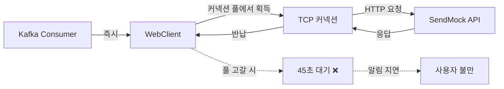

# 3주차 과제 - 즉시 발송 알림 시스템의 HTTP 커넥션 풀 아키텍처 의사결정

## 📝 개괄 (Overview)
본 시스템은 사용자에게 알림을 **즉시 발송**하는 것이 핵심 목적입니다. Kafka 컨슈머가 메시지를 소비하는 순간부터 외부 API(SendMock)를 통해 실제 발송이 완료되기까지의 **레이턴시를 최소화**해야 하며, 동시에 외부 API 장애가 내부 시스템을 마비시키지 않아야 합니다.

이 문서는 즉시 발송이라는 서비스 특성을 고려하여, WebClient/Reactor Netty 기반 HTTP 클라이언트의 **커넥션 풀(Connection Pool) 기본값의 함정**을 분석하고, "**빠르게 보내되, 보낼 수 없으면 빠르게 포기하고 재시도 파이프라인에 맡긴다**"는 설계 철학 하에 내린 아키텍처 의사결정을 정리합니다.

### 🎯 즉시 발송 시스템에서 커넥션 풀이 중요한 이유



- **정상 흐름**: 풀에 여유 커넥션이 있으면 → 즉시 획득 → 즉시 발송 → 레이턴시 최소
- **풀 고갈 시 (기본값)**: 45초간 커넥션 대기 → 알림이 45초 지연 → **"즉시 발송"이 아니게 됨**
- **풀 고갈 시 (개선 후)**: 5초 내 빠른 실패 → 서킷 브레이커/Retry 토픽으로 넘겨서 재시도 → 다른 알림은 계속 처리

## 📖 목차 (Table of Contents)

**1. 클라이언트 및 DB 커넥션 아키텍처**
- [1.1. HTTP 클라이언트(WebClient) 싱글톤 관리 및 커넥션 풀 재사용](#11-http-클라이언트webclient-싱글톤-관리-및-커넥션-풀-재사용)
- [1.2. HTTP 커넥션 풀 명시적 설정 (ConnectionProvider 기본값의 함정)](#12-http-커넥션-풀-명시적-설정-connectionprovider-기본값의-함정)
- [1.3. DB 커넥션 풀(HikariCP) 최적화 — 처리 능력(Throughput) 중심 설계](#13-db-커넥션-풀hikaricp-최적화--처리-능력throughput-중심-설계)
- [1.4. DB 커넥션 풀 vs 톰캣 스레드 풀 정합성 조율](#14-db-커넥션-풀-vs-톰캣-스레드-풀-정합성-조율)

**2. 타임아웃 및 장애 대응**
- [2.1. 타임아웃 4단계 세분화 전략 (HTTP)](#21-타임아웃-4단계-세분화-전략-http)
- [2.2. 커넥션 풀 상태 모니터링 (Metrics + Grafana)](#22-커넥션-풀-상태-모니터링-metrics--grafana)

**3. 기술 선택 및 관측성(Observability)**
- [3.1. HTTP 클라이언트 엔진 선택 (Reactor Netty vs Apache HttpClient vs JDK HttpClient)](#31-http-클라이언트-엔진-선택)
- [3.2. 인프라 지표 및 성능 파악 가이드 (네트워크, 슬로우 쿼리, DB I/O)](#32-인프라-지표-및-성능-파악-가이드-네트워크-슬로우-쿼리-db-io)

## 🚀 진행 내용 요약 (Progress Summary)
- **서비스 목적 기반 설계**: "즉시 발송"이라는 핵심 요구사항 하에, HTTP/DB 커넥션 풀 설정을 **"빠르게 처리하되, 지연되면 빠르게 포기(Fail-Fast)"** 전략으로 통일. 대기(Queueing)로 인한 앱 전체 마비를 방지.
- **HTTP 커넥션 풀 튜닝**: Reactor Netty의 기본값(`pendingAcquireTimeout=45초`)의 함정을 분석하고, `ConnectionProvider.builder()`를 통해 5초 내 실패하도록 단축 및 1배치(100건) 동시 처리가 가능하게 풀 크기 조정.
- **DB 커넥션 풀(HikariCP) 튜닝**: "풀 크기가 크다고 빠른 것이 아니다"라는 원칙 하에, HikariCP 공식(`CPU*2 + 1`)을 반영해 `maximum-pool-size=10`을 채택. 대신 `connection-timeout=3초`로 단축하여 데드락/슬로우 쿼리 발생 시 톰캣 스레드 풀 고갈을 방어.
- **관측성(Observability) 가이드라인 확립**: 네트워크 레이턴시, DB I/O 사용률, 슬로우 쿼리를 식별하기 위한 Prometheus/Grafana 지표 수집 체계 정리.

---

## 1.1. HTTP 클라이언트(WebClient) 싱글톤 관리 및 커넥션 풀 재사용

#### ❓ 고민하게 된 구체적 문제 상황
- **즉시 발송의 핵심 병목 = 외부 API 호출 레이턴시**: Kafka 컨슈머가 메시지를 소비한 뒤 SendMock API를 호출하는 구간이 전체 파이프라인에서 가장 느린 구간(네트워크 I/O)임. 이 구간의 레이턴시를 줄이는 것이 "즉시 발송"의 핵심.
- **요청마다 HTTP 클라이언트를 새로 생성하면?**: 코드 리뷰 과정에서 RestClient/WebClient를 요청(Request)마다 `new`로 생성하는 패턴이 왜 위험한지에 대한 검토 요구가 발생.
- **표면적 문제 vs 진짜 문제**:
  - 표면적: 객체 생성 비용 → 사실 큰 문제 아님
  - **진짜 문제 = TCP 커넥션**: 매 요청마다 TCP 3-way Handshake 발생 (HTTPS면 TLS Handshake까지), 클라이언트를 새로 만들면 내부 **커넥션 풀도 매번 새로 생성** → 풀이 항상 비어있는 상태에서 시작 → Keep-Alive 재사용 불가
- **알림 시스템에서의 사고 시나리오**:
  - 매번 핸드셰이크 → 알림 1건당 수십~수백ms 추가 지연 → 대량 발송 시 **발송 지연 누적**
  - 커넥션 폭증 → SendMock 서버 과부하 → 서버가 요청 거부 → **알림 발송 실패**
  - TIME_WAIT 소켓 누적 → OS 파일 디스크립터 고갈 → **앱 전체 장애, 모든 알림 발송 중단**

---

#### ⚖️ 대안 비교

**A안: 요청마다 WebClient/HttpClient 새로 생성**
- **장점**: 테스트 시 격리성이 높고, 상태 공유 걱정이 없음.
- **단점**: 매 요청마다 TCP Handshake 비용 발생, 커넥션 풀 재사용 불가, Keep-Alive 활용 불가 → 실운영에서 치명적 성능 저하.

**B안: @Component 싱글톤 Bean으로 1회 생성 후 재사용 (선택)**
- **장점**: TCP 커넥션 풀 재사용으로 핸드셰이크 비용 절감, 리소스 효율 극대화, Keep-Alive로 커넥션 유지.
- **단점**: 풀 설정이 애플리케이션 전체에 영향, 외부 API별 분리 시 별도 Bean 필요.

---

#### ✅ 결정: B안 (싱글톤 Bean 기반 WebClient 재사용)
- **선택 사유**: 즉시 발송 시스템에서는 알림 1건의 레이턴시가 곧 사용자 체감 품질입니다. HTTP 클라이언트를 싱글톤으로 유지하면 **이미 열린 TCP 커넥션을 즉시 재사용**할 수 있어, 핸드셰이크 없이 바로 발송 요청을 보낼 수 있습니다. 이것이 "즉시"를 실현하는 가장 기본적인 전제 조건입니다.

#### ❌ 포기한 것
- 요청별 WebClient 생성의 **테스트 격리성**: 실운영에서 알림마다 핸드셰이크가 발생하면 대량 발송 시 수초~수십초의 누적 지연이 생기므로 포기. 테스트 격리는 Mock 서버나 WireMock으로 별도 대응.

---

#### 💻 적용 코드 예시
```kotlin
@Component // ← Spring 싱글톤: 애플리케이션에 단 하나만 존재
class MockApiNotificationAdapter(...) : NotificationPort {

    // 클래스 멤버 변수로 1회만 생성 → 모든 요청에서 재사용
    private val connectionProvider = ConnectionProvider.builder("mock-api").build()
    private val httpClient = HttpClient.create(connectionProvider)
    private val webClient = WebClient.builder()
        .clientConnector(ReactorClientHttpConnector(httpClient))
        .build()

    override fun sendNotification(items: List<AlarmBatchItem>): Mono<Void> {
        // 이미 생성된 webClient 재사용 → 커넥션 풀에서 기존 TCP 커넥션을 빌려씀
        return webClient.post()
            .uri("/mock/send")
            .retrieve()
            .bodyToMono(Void::class.java)
    }
}
```

<br>

## 1.2. HTTP 커넥션 풀 명시적 설정 (ConnectionProvider 기본값의 함정)

#### ❓ 고민하게 된 구체적 문제 상황
- **기본값의 함정 발견**: `HttpClient.create()`를 호출하면 내부적으로 `ConnectionProvider.create("http")`가 실행되어 기본 커넥션 풀이 생성됩니다. 프레임워크 소스코드(`reactor.netty.resources.ConnectionProvider`)를 `Ctrl+Click`으로 직접 추적한 결과, 다음과 같은 기본값이 적용됨을 확인했습니다:

| 설정 | Reactor Netty 기본값 | 즉시 발송 시스템에서의 위험성 |
|------|------|------|
| `maxConnections` | `Math.max(CPU코어, 8) × 2` | 4코어 서버에서 고작 16개 → Outbox 스케줄러가 100건 배치 발송 시 **16건만 동시 처리**, 나머지 84건은 대기 |
| `pendingAcquireTimeout` | **45초** | 풀 고갈 시 알림이 **45초간 지연** → "즉시 발송"이 아닌 "45초 후 발송" |
| `maxIdleTime` | **-1 (무제한)** | 서버가 먼저 끊은 stale connection으로 알림 발송 시도 → 발송 실패 |
| `maxLifeTime` | **-1 (무제한)** | DNS 변경 후에도 옛날 IP로 발송 시도 → SendMock 서버 교체 시 장애 |
| `metrics` | **false** | 대량 발송 시 풀이 고갈되고 있는지 사전 감지 불가 |

- **즉시 발송 시스템에서의 사고 시나리오**: 
  1. SendMock API 응답 지연 발생 (예: 네트워크 순단, 서버 과부하)
  2. 발송 중인 커넥션이 반납되지 않음 → `maxConnections`(16개) 전부 사용 중 → 풀 고갈
  3. **새로 들어온 알림들**이 `pendingAcquireTimeout`(45초) 동안 커넥션 대기
  4. 이 시간 동안 Kafka에서 계속 메시지가 쌓이지만 발송 불가 → **알림 발송 지연 누적**
  5. 서킷 브레이커가 OPEN되기 전에 이미 수백 건의 알림이 45초씩 지연 → **사용자가 알림을 못 받음**

- **프레임워크 내부 추적 경로**: 
  ```
  HttpClient.create()
    → HttpConnectionProvider()          // http1ConnectionProvider = null
      → http1ConnectionProvider()       // null이므로 fallback
        → HttpResources.get()           // 글로벌 싱글톤
          → ConnectionProvider.create("http")  // ★ 기본값이 여기에!
            → DEFAULT_POOL_MAX_CONNECTIONS = CPU × 2
            → DEFAULT_POOL_ACQUIRE_TIMEOUT = 45000ms
  ```

---

#### ⚖️ 대안 비교

**A안: 기본값에 의존 (무설정)**
- **장점**: 코드가 간결하고 설정할 것이 없음.
- **단점**: `pendingAcquireTimeout=45초`로 인해 풀 고갈 시 앱이 45초간 hang. `maxIdleTime=무제한`으로 stale connection 잔류. 프로덕션에서 치명적.

**B안: `ConnectionProvider.elastic()` (무제한 풀)**
- **장점**: 커넥션 부족 상황이 발생하지 않음.
- **단점**: 외부 API 장애 시 소켓이 무한 증가 → OS 파일 디스크립터 한계(`ulimit -n`) 도달 → 시스템 전체 장애.

**C안: `ConnectionProvider.builder()`로 명시적 설정 (선택)**
- **장점**: 풀 크기, 대기 시간, 유휴 정리, 수명 제한, 모니터링을 모두 제어 가능. 환경별 튜닝 가능.
- **단점**: 설정이 많아져 관리 복잡도 증가. 적정 `maxConnections` 값 산정을 위해 부하 테스트 필요.

---

#### ✅ 결정: C안 (ConnectionProvider.builder()를 통한 전 항목 명시적 설정)
- **선택 사유**: 
  - **즉시 발송의 핵심 원칙 = "빠르게 보내되, 보낼 수 없으면 빠르게 포기"**: 풀이 고갈되어 발송이 불가능한 상황에서 45초를 기다리는 것은 "즉시"가 아닙니다. 5초 내 실패시키고 기존 Kafka Retry 토픽 + 서킷 브레이커 파이프라인에 위임하는 것이 전체 시스템의 발송 처리량을 유지하는 최선의 전략입니다.
  - **`maxConnections=100`의 근거**: Outbox 스케줄러의 `batch-size=100`(application.yml)과 맞춰, 동시에 다량의 알림 발송 트래픽이 몰려도 병목 없이 처리 가능하도록 여유 있게 설정.
  - **`pendingAcquireTimeout=5초`의 근거**: 기존 `responseTimeout=5초` + 서킷 브레이커 `slow-call-duration-threshold=3초`와 조화. 풀 대기 5초 + 응답 대기 5초 = 최악의 경우에도 10초 이내에 실패 판정 → 서킷 브레이커로 넘김.
  - 모든 설정값을 `application.yml`에 환경변수로 외부화하여 트래픽 증가 시 재배포 없이 튜닝 가능.

#### ❌ 포기한 것
- **기본값 의존의 코드 간결성**: 한 줄(`HttpClient.create()`)로 끝나는 단순함을 포기. 대신 풀 고갈 시 빠른 실패를 보장.
- **`elastic()` 무제한 풀의 편의성**: 커넥션 부족은 없지만, SendMock 장애 시 소켓이 무한 증가하면 OS가 죽고 **모든 알림 채널(Kafka, Redis, DB 포함)이 마비**되므로 포기. 알림 시스템에서 "일부 지연"보다 "전체 마비"가 훨씬 치명적.
- **알림 발송 보장(at-least-once)의 일부 타협**: `pendingAcquireTimeout=5초` 내에 커넥션을 못 얻으면 해당 알림은 **즉시 실패** 처리됨. 하지만 이 실패는 Kafka Retry 토픽(`alarm-jobs-retry`)으로 재발행되어 재시도되므로, 최종적으로는 발송이 보장됨.

---

#### 💻 적용 코드 예시

**1. ConnectionProvider 설정 (MockApiNotificationAdapter.kt)**
```kotlin
/**
 * 커넥션 풀 설정 (ConnectionProvider)
 * - maxConnections:        동일 목적지(host:port)에 동시에 열 수 있는 최대 커넥션 수
 * - pendingAcquireTimeout: 풀에서 커넥션을 빌리기까지 최대 대기 시간 (45초 → 5초로 단축)
 * - maxIdleTime:           유휴 커넥션 유지 시간 (무제한 → 30초)
 * - maxLifeTime:           커넥션 최대 수명 (무제한 → 5분)
 * - evictInBackground:     백그라운드에서 주기적으로 유휴/만료 커넥션 정리 (60초 주기)
 * - metrics:               Micrometer를 통해 풀 상태를 Prometheus/Grafana에 노출
 */
private val connectionProvider = ConnectionProvider.builder("mock-api")
    .maxConnections(maxConnections)                                       // 1순위
    .pendingAcquireTimeout(Duration.ofSeconds(pendingAcquireTimeoutSeconds)) // 1순위
    .maxIdleTime(Duration.ofSeconds(maxIdleTimeSeconds))                  // 2순위
    .maxLifeTime(Duration.ofSeconds(maxLifeTimeSeconds))                  // 3순위
    .evictInBackground(Duration.ofSeconds(evictIntervalSeconds))          // 3순위
    .metrics(metricsEnabled)                                              // 3순위
    .build()

private val httpClient = HttpClient.create(connectionProvider) // ← 명시적 전달
    .option(ChannelOption.CONNECT_TIMEOUT_MILLIS, connectTimeoutMillis)
    .responseTimeout(Duration.ofSeconds(responseTimeoutSeconds))
    .doOnConnected { conn ->
        conn.addHandlerLast(ReadTimeoutHandler(readTimeoutSeconds))
            .addHandlerLast(WriteTimeoutHandler(writeTimeoutSeconds))
    }
```

**2. application.yml 외부화 설정**
```yaml
mock:
  api:
    pool:
      max-connections: ${MOCK_API_POOL_MAX_CONNECTIONS:100}
      pending-acquire-timeout-seconds: ${MOCK_API_POOL_ACQUIRE_TIMEOUT:5}
      max-idle-time-seconds: ${MOCK_API_POOL_MAX_IDLE:30}
      max-life-time-seconds: ${MOCK_API_POOL_MAX_LIFE:300}
      evict-interval-seconds: ${MOCK_API_POOL_EVICT_INTERVAL:60}
      metrics-enabled: ${MOCK_API_POOL_METRICS:true}
```

#### 📊 기본값 vs 적용값 비교 (즉시 발송 시스템 기준)

| 설정 | Reactor Netty 기본값 | 적용값 | 알림 시스템에서의 변경 근거 |
|------|------|------|------|
| `maxConnections` | CPU × 2 (최소 16) | **100** | Outbox `batch-size=100`과 일치 → 1배치 전량 동시 발송 가능 |
| `pendingAcquireTimeout` | 45초 | **5초** | 45초 지연 = "즉시 발송" 실패. 5초 내 실패 → Retry 토픽으로 재시도 |
| `maxIdleTime` | 무제한 | **30초** | 유휴 커넥션이 stale 상태로 남으면 알림 발송 시 즉시 실패 발생 |
| `maxLifeTime` | 무제한 | **300초 (5분)** | SendMock 서버 교체/DNS 변경 시 자동 반영. 알림이 잘못된 서버로 가는 것 방지 |
| `evictInBackground` | 비활성 | **60초** | 발송 피크 이후 불필요한 커넥션을 정리하여 리소스 확보 |
| `metrics` | false | **true** | 대량 발송 시 풀 고갈 **사전 감지** → 알림 지연 장애 예방 |

<br>

## 1.3. DB 커넥션 풀(HikariCP) 최적화 — 처리 능력(Throughput) 중심 설계

#### ❓ 고민하게 된 구체적 문제 상황
- **"커넥션 풀을 늘리면 TPS가 오를까?"**: 개발 환경(로컬)에서는 문제가 없으나, 스테이징/운영 분리 환경으로 전환 시 갑자기 알림 처리 TPS가 감소하고 레이턴시가 튀는 현상 발생. 
- **막연한 설정의 위험**: 동시 요청이 많다고 무작정 HikariCP의 `maximum-pool-size`를 100~200개로 올리면 해결될 것이라 착각하기 쉬움. 하지만 이는 데이터베이스의 물리적 한계를 무시한 치명적 안티패턴임.

---

#### 💡 로컬 vs 분리 환경의 차이 (관측 한계)
| 항목 | 로컬 환경 (단일 머신) | 분리 환경 (운영, WAS - DB 분리) |
|---|---|---|
| **네트워크 Latency** | `loopback`, 거의 0ms | **TCP RTT 누적 (수십~수백ms)** |
| **자원 경쟁** | 앱과 DB가 CPU/RAM을 서로 뺏음 | 각자 독립된 자원 온전히 사용 |
| **병목 지점** | 단일 코어 성능 / 메모리 부족 | **네트워크 지연 + DB 커넥션 락 경합** |
| **결과** | 네트워크 지연이 없어 쿼리가 빨리 끝나 풀 회전이 빠름 | RTT 추가로 쿼리 소요 시간이 길어짐 → 풀 점유 시간 길어짐 → **풀 고갈 체감** |

- 로컬에서는 네트워크 지연(0ms) 때문에 DB 커넥션 병목이 가려져 보이지 않다가, 서버 분리 시 TCP 통신 비용이 발생하며 갑자기 DB 풀 고갈이 발생합니다.

---

#### ⚖️ 대안 비교 및 결정

**A안: 무작정 풀 크기 증설 (안티패턴)**
- `maximum-pool-size=100`으로 증가.
- **결과**: DB 엔진의 물리적 코어 한계(예: 4코어)를 초과한 다수의 커넥션이 활성화되면, DB 내부에서 **컨텍스트 스위칭 오버헤드**와 **스토리지 I/O 락(Lock) 경쟁**이 극심해짐. 
- 10개의 쿼리를 빨리 끝내고 다음 10개를 받는 게 나은데, 100개를 억지로 욱여넣어 "큐잉" 없이 동시 처리하려다 결국 **모두가 느려지고 TPS가 추락**함. (정합성 파괴, 데드락 발생 위험)

**B안: "DB가 동시에 처리할 수 있는 만큼"만 할당 (선택)**
- HikariCP 공식 권장값: `(DB 서버 CPU 코어 × 2) + 디스크 Spindle 수 (SSD는 1)`
- 4코어 SSD 기준: `(4 × 2) + 1 = 9` (보수적으로 10 설정)

---

#### ✅ 결정: B안 (HikariCP 공식 반영 및 Fail-Fast 타임아웃)
- **`maximum-pool-size = 10`**: 알림 발송 도메인의 DB 작업은 `조회(Outbox 폴링)` 및 `단건 상태 저장(UPDATE)` 위주로 쿼리가 매우 짧고 빠릅니다. 큰 풀 사이즈는 무의미하며 오히려 독이 됩니다.
- **`connection-timeout = 3000 (3초)`**: (기본값 30초). DB 락 웨이트(Lock Wait)나 슬로우 쿼리로 인해 풀이 꽉 찼을 때, 새 알림 요청이 30초나 대기하면 톰캣/워커 스레드가 고갈되어 전체 시스템이 마비됩니다. 3초 안에 못 빌리면 빠르게 실패(Timeout) 처리하여 사용자에게 에러를 응답하거나 Kafka에서 재시도를 타도록 해야 시스템이 생존합니다.

#### 📊 DB 커넥션 아키텍처 (참고)
- **WAS 대수 × Pool Size ≤ DB max_connections**: 서버가 3대면 DB쪽엔 30개의 커넥션이 생깁니다. DB의 최대 수용치를 넘지 않도록 계산 필수.
- **PostgreSQL vs MySQL 모델 차이**:
  - PostgreSQL: `Per Process` 모델. 커넥션 1개당 OS 프로세스 1개 생성 (매우 무거움). 기본 `max_connections=100` 내외 권장. PgBouncer 같은 미들웨어 필수.
  - MySQL: `Per Thread` 모델. 가볍지만 무한정 늘리면 안 됨. 기본 151.

---

#### 💻 적용 코드 예시 (`application.yml`)
```yaml
spring:
  datasource:
    hikari:
      pool-name: AlarmDBPool                   # 모니터링 식별용
      maximum-pool-size: 10                    # (CPU * 2) + 1 기반의 최적 사이즈
      minimum-idle: 5                          # 즉시 발송을 위한 워밍업 상태 유지
      connection-timeout: 3000                 # [중요] 3초 내 못 구하면 빠른 실패 (Fail-Fast)
      max-lifetime: 1800000                    # (30분) DB의 wait_timeout보다 짧게 (좀비 방지)
      idle-timeout: 600000                     # (10분) 유휴 정리
```

<br>

## 1.4. DB 커넥션 풀 vs 톰캣 스레드 풀 정합성 조율

#### ❓ 고민하게 된 구체적 문제 상황
- **부하 테스트 시 DB 커넥션 한도 초과 에러 (`FATAL: sorry, too many clients already`) 발생**: k6 부하 테스트 도중 트래픽이 폭주하자, 애플리케이션(HikariCP)이 맺으려는 커넥션 개수가 데이터베이스의 `max_connections` 한도를 초과하여 요청이 강제 거부되는 장애 발생.
- **톰캣 스레드와 DB 풀 사이즈의 불일치**: 알림 API는 수신, 상태 업데이트, 발송 이력 저장 등 대부분의 요청이 DB 접근을 동반함. Tomcat의 기본 스레드 풀(200개)이 동시에 요청을 처리하려 할 때, DB 커넥션 풀 사이즈나 DB 본체의 허용량이 이를 받쳐주지 못하면 병목 또는 거부 현상이 일어남.

#### ⚖️ 대안 비교

**A안: "DB 커넥션 풀(Hikari) < 톰캣 스레드(Tomcat)" (기존 권장 모델)**
- **특징**: Tomcat 스레드가 200개일 때, Hikari 풀 사이즈를 10~50개 정도로 적게 유지.
- **장점**: DB 자체에 가해지는 컨텍스트 스위칭 부하 및 락(Lock) 경합을 최소화.
- **단점**: 대규모 알림 트래픽 폭주 시 많은 톰캣 스레드가 DB 커넥션을 얻기 위해 대기(Waiting)하게 되며, `connection-timeout`(3초) 내에 얻지 못해 수많은 알림 건이 Fail-Fast 에러를 발생. 이후 카프카 Retry 큐로 넘어가 "즉시 발송" 요건을 해침.

**B안: "DB 커넥션 풀(Hikari) ≥ 톰캣 스레드(Tomcat)" (선택)**
- **특징**: Tomcat 최대 스레드가 200개면, Hikari 풀 사이즈도 200개로 맞추어 모든 스레드가 동시에 DB에 접근할 수 있도록 통로를 열어줌.
- **장점**: 스레드가 DB 커넥션을 얻기 위해 앱 내부에서 대기하는 시간이 사라져 커넥션 타임아웃 에러를 원천 방지함. 알림 발송 파이프라인의 처리 지연(Latency)이 급감.
- **단점**: 피크 시 DB 쪽에 동시에 200개의 트랜잭션이 인입되므로, DBMS 설정(`max_connections`) 확장이 필수적이며 DB 자체의 메모리/CPU 사용률이 급증함.

#### ✅ 결정: B안 (Hikari 최대 풀 200개, 톰캣 최대 스레드 200개 명시, DB max_connections 300개 설정)
- **기준 (서비스 성격)**: 본 시스템은 "즉시 발송 알림" 시스템이므로, 트래픽 피크 상황에서도 내부 큐잉으로 인한 지연(Latency)보다 동시 다발적인 빠른 처리(Throughput)가 최우선 목표임. 모든 API 요청(Tomcat 스레드)이 멈추지 않고 즉시 DB I/O를 수행해야 함.
- **선택한 이유**: 
  - 현재 아키텍처가 단일 서버(WAS 1대)로 구성되어 있으므로, 1대 서버가 가진 최대 동시성(스레드 200)을 막힘 없이 소화하려면 DB 통로(커넥션)도 1:1 이상으로 열어주어야 병목이 제거됨.
  - 이를 위해 `docker-compose.perf.yml`에서 PostgreSQL의 `max_connections`를 300으로 넉넉히 확장하여 `too many clients already` 에러를 차단함.
  - `application-perf.yml`에 `server.tomcat.threads.max: 200`을 명시하여, "스레드 수 ≤ DB 풀 수"라는 정합성 의도를 코드화함.
- **포기해야 할 것 (Trade-offs)**: 
  - **전통적인 DB 자원 최적화 포기**: 일반적으로 권고되는 "소규모 풀 기반의 컨텍스트 스위칭 최소화" 아키텍처를 포기하고, 하드웨어(충분한 메모리를 갖춘 DB)의 자원을 최대로 소모하며 트래픽을 밀어내는 방식을 택함. 향후 스케일 아웃으로 WAS 대수가 늘어나면 DB가 1:1 정합성을 버티지 못하므로 PgBouncer 같은 커넥션 풀러(Connection Pooler) 도입이 강제됨.

#### 💻 적용 코드 예시 (`application-perf.yml` 및 `docker-compose-perf.yml`)
```yaml
# application-perf.yml
server:
  tomcat:
    threads:
      max: 200    # 톰캣 워커 스레드 최대치

spring:
  datasource:
    hikari:
      maximum-pool-size: 200   # 톰캣 스레드 수와 1:1 정합성
```
```yaml
# docker-compose-perf.yml
  postgres-perf:
    image: postgres:15-alpine
    command: postgres -c max_connections=300  # DB 수용량 넉넉히 확보
```


<br>

## 2.1. 타임아웃 4단계 세분화 전략 (HTTP)

#### ❓ 고민하게 된 구체적 문제 상황
- **알림 발송 실패 원인 파악의 어려움**: "알림이 안 갔다"는 CS가 들어왔을 때, TCP 연결 자체가 안 된 건지(SendMock 서버 다운), 연결은 됐는데 응답이 안 온 건지(서버 과부하), 요청을 보내다 끊긴 건지(네트워크 불안정) 구분할 수 없으면 **장애 대응이 불가능**.
- **즉시 발송 시스템의 타임아웃 민감성**: 알림은 빨리 보내야 하므로 타임아웃을 짧게 잡아야 함. 하지만 단일 타임아웃만 있으면 "TCP 연결에 4초 + 응답에 0.5초"와 "TCP 연결에 0.1초 + 응답에 4.4초"를 구분할 수 없어, **어느 구간을 개선해야 할지 판단 불가**.
- **기존 Resilience 전략과의 연계**: 서킷 브레이커(`slow-call-duration-threshold=3초`)와 타임아웃 값이 정합성을 가져야, 느린 호출이 정확히 감지되어 서킷이 올바르게 동작함.

---

#### ⚖️ 대안 비교

**A안: 단일 타임아웃 (`responseTimeout`만 설정)**
- **장점**: 설정이 단순하고 관리가 쉬움.
- **단점**: 장애 원인을 구분할 수 없고, 특정 단계의 문제만 잡아내는 것이 불가능. 예: 연결은 1초 만에 됐는데 서버가 4.9초 뒤에 응답을 시작한 경우와, 연결 자체에 4.9초가 걸린 경우를 구분 불가.

**B안: 4단계 세분화 (connect + write + read + response) (선택)**
- **장점**: 각 단계별 독립적 장애 감지 및 로그 구분 가능. 에러 타입별 정확한 원인 분석.
- **단점**: 설정값 간의 관계(`responseTimeout ≥ readTimeout + writeTimeout`)를 이해하고 관리해야 함. 적정값 산정을 위해 실제 트래픽 측정 필요.

---

#### ✅ 결정: B안 (4단계 타임아웃 세분화)
- **선택 사유**: 
  - **즉시 발송 시스템의 장애 대응**: 알림 미발송 CS 인입 시 "SendMock 서버 자체가 다운인가(connectTimeout)" vs "서버는 살아있는데 과부하인가(readTimeout)" 구분이 즉시 가능.
  - `ReadTimeoutException` → 기존 `onErrorMap`에서 `ReadTimeoutExternalException`으로 변환 → 서킷 브레이커의 `slow-call` 감지에 정확히 기여.
  - **responseTimeout(5초)이 가장 바깥 안전장치**: connect + write + read가 개별 기준은 통과하더라도, 전체 합산이 5초를 넘으면 강제 종료 → 알림 1건에 5초 이상 소비되지 않도록 보장.

#### ❌ 포기한 것
- **단일 타임아웃의 구현 단순성**: 설정 하나로 끝나는 편의성을 포기. 대신 알림 발송 실패의 정확한 원인을 특정할 수 있는 운영 가시성을 확보.

---

#### 💻 적용 코드 예시 및 각 단계별 역할

```kotlin
private val httpClient = HttpClient.create(connectionProvider)
    // ① TCP 연결 타임아웃 (3-way Handshake 완료 시간)
    .option(ChannelOption.CONNECT_TIMEOUT_MILLIS, 5000)  // 5초
    
    // ④ 전체 응답 타임아웃 (요청 시작 ~ 응답 완료, 가장 바깥 안전장치)
    .responseTimeout(Duration.ofSeconds(5))               // 5초
    
    .doOnConnected { conn ->
        // ③ 읽기 타임아웃 (서버 → 클라이언트, Response Body 수신)
        conn.addHandlerLast(ReadTimeoutHandler(3))        // 3초
        
        // ② 쓰기 타임아웃 (클라이언트 → 서버, Request Body 전송)
            .addHandlerLast(WriteTimeoutHandler(2))       // 2초
    }
```

#### 📊 타임아웃 구간 다이어그램
```
  ┌─── connectTimeout (5s) ───┐
  │     TCP Handshake         │
  └───────────────────────────┘
  ┌─── writeTimeout (2s) ─────┐
  │   Request Body 전송        │
  └───────────────────────────┘
  ┌─── readTimeout (3s) ──────┐
  │   Response Body 수신       │
  └───────────────────────────┘
  ┌───── responseTimeout (5s) ─────────────────────┐
  │   요청 시작 ~ 응답 완료 전체 (가장 바깥 안전장치)    │
  └─────────────────────────────────────────────────┘
```

#### 🎯 슬라이드 4대 핵심값 ↔ Reactor Netty 매핑

| 슬라이드 (Apache HttpClient) | Reactor Netty 대응 | 적용값 |
|------|------|:---:|
| `connectTimeout` — TCP 연결 | `ChannelOption.CONNECT_TIMEOUT_MILLIS` | 5초 |
| `socketTimeout` — 응답 대기 | `ReadTimeoutHandler` + `responseTimeout` | 3초 / 5초 |
| `connectionRequestTimeout` — 풀 대여 | `ConnectionProvider.pendingAcquireTimeout` | 5초 |
| `maxConnPerRoute` — 서버당 상한 | `ConnectionProvider.maxConnections` | 100 |

<br>

## 2.2. 커넥션 풀 상태 모니터링 (Metrics + Grafana)

#### ❓ 고민하게 된 구체적 문제 상황
- **대량 발송 시 풀 고갈의 사전 감지 불가**: 이벤트 프로모션, 긴급 공지 등으로 알림 발송량이 급증하면 커넥션 풀이 순식간에 소진됩니다. 하지만 로그에는 아무런 경고가 나오지 않고, `pendingAcquireTimeout` 예외가 터져야 비로소 인지 → **이미 수백 건의 알림이 지연된 뒤**.
- **블랙박스 상태**: `maxConnections=100`으로 설정해도, 현재 몇 개가 발송에 사용 중이고 몇 건의 알림이 커넥션 대기 중인지 알 방법이 없음. 대량 발송 이벤트 전에 풀 크기를 사전 조정할 판단 근거가 없음.
- **기존 Prometheus/Grafana 인프라 활용**: `application.yml`에 이미 Prometheus가 활성화되어 있고, 서킷 브레이커 메트릭도 수집 중이므로, HTTP 커넥션 풀 메트릭만 추가하면 **알림 발송 인프라의 전체 건강 상태를 한 대시보드에서 모니터링** 가능.

---

#### ⚖️ 대안 비교

**A안: 로그 기반 모니터링 (사후 분석)**
- **장점**: 추가 설정 없이 에러 로그만으로 파악.
- **단점**: 장애가 터진 후에야 인지 가능. 선행 지표(pending connections 증가) 감지 불가.

**B안: ConnectionProvider.metrics(true) + Prometheus/Grafana (선택)**
- **장점**: `active`, `idle`, `pending`, `total` connections를 실시간으로 Grafana 대시보드에서 확인. `pending > 10`이면 알림 설정 가능 → 장애 **사전** 감지.
- **단점**: Micrometer 의존성 필요 (이미 존재). 메트릭 수집 시 극미세한 성능 오버헤드.

---

#### ✅ 결정: B안 (ConnectionProvider.metrics(true) + Prometheus 연동)
- **선택 사유**: 이미 Prometheus + Grafana 인프라가 구축되어 있어, `.metrics(true)` 한 줄 추가만으로 커넥션 풀 상태를 실시간 모니터링할 수 있는 효율적인 선택.

#### ❌ 포기한 것
- **제로 오버헤드의 무설정 상태**: 메트릭 수집 시 극미세한 성능 오버헤드를 감수. 풀 고갈 사전 감지 이점이 압도적으로 큼.

---

#### 💻 적용 코드 예시
```kotlin
private val connectionProvider = ConnectionProvider.builder("mock-api")
    // ... 다른 설정들
    .metrics(true)  // ← 이것만 추가!
    .build()
```

#### 📊 노출되는 Prometheus 메트릭 목록

| 메트릭 이름 | 의미 | 경보 조건 예시 |
|------|------|------|
| `reactor.netty.connection.provider.active.connections` | 현재 사용 중인 커넥션 수 | — |
| `reactor.netty.connection.provider.idle.connections` | 놀고 있는 커넥션 수 | — |
| `reactor.netty.connection.provider.pending.connections` | **커넥션 대기 중인 요청 수** | > 10이면 경보 |
| `reactor.netty.connection.provider.total.connections` | 전체 커넥션 수 | maxConnections 근접 시 경보 |
| `reactor.netty.connection.provider.max.connections` | 설정된 최대 커넥션 수 | — |

#### 🎯 정상 vs 위험 상태 비교
```
정상:  active=10, idle=6, pending=0   ← 여유 있음
경고:  active=85, idle=0, pending=5   ← 풀 소진 시작
위험:  active=100, idle=0, pending=23 ← 풀 꽉 참, 23개 대기 중!
```

<br>

## 3.1. HTTP 클라이언트 엔진 선택

#### ❓ 고민하게 된 구체적 문제 상황
- 슬라이드에서는 **Apache HttpClient를 깔아끼우고 명시 설정**을 하라고 권장하지만, 현재 프로젝트는 Spring WebFlux 기반의 리액티브 파이프라인을 사용 중.
- RestClient(동기) + Apache HttpClient vs WebClient(비동기) + Reactor Netty 중 어떤 조합이 적합한지 검토 필요.

---

#### ⚖️ 대안 비교

| 구분 | Reactor Netty (선택) | Apache HttpClient 5 | JDK HttpClient |
|------|:---:|:---:|:---:|
| **비동기/논블로킹** | ✅ 네이티브 | ⚠️ Async 별도 설정 | ✅ (Java 11+) |
| **커넥션 풀** | ✅ `ConnectionProvider` | ✅ `PoolingHttpClientConnectionManager` | ❌ 풀 없음 (무제한) |
| **타임아웃 세분화** | ✅ 4단계 | ✅ 3단계 (connect/socket/connectionRequest) | ⚠️ 2단계 (connect/request) |
| **Spring WebFlux 호환** | ✅ 기본 엔진 | ❌ WebFlux 미지원 | ⚠️ 제한적 |
| **Micrometer 메트릭** | ✅ 내장 | ⚠️ 별도 설정 | ❌ 없음 |
| **HTTP/2 지원** | ✅ | ✅ | ✅ |

---

#### ✅ 결정: Reactor Netty 유지
- **선택 사유**: 
  - 프로젝트가 **Spring WebFlux + Kafka 비동기 파이프라인** 기반이므로 Reactor Netty가 자연스러운 선택.
  - 별도 의존성 추가 없이 `ConnectionProvider`로 풀을 제어할 수 있고, Micrometer 메트릭이 내장되어 Prometheus/Grafana 연동이 간편.
  - 슬라이드에서 권장하는 Apache HttpClient의 4대 핵심값을 Reactor Netty의 동일한 설정으로 모두 대응 가능.

#### ❌ 포기한 것
- **Apache HttpClient의 성숙한 풀 관리**: 동기(MVC) 프로젝트에서는 최적이지만, WebFlux와 호환되지 않으므로 포기.
- **JDK HttpClient의 제로 의존성**: 경량이지만 커넥션 풀과 메트릭 기능이 없어 프로덕션 운영에 부적합.

<br>

## 3.2. 인프라 지표 및 성능 파악 가이드 (네트워크, 슬로우 쿼리, DB I/O)

외부 시스템 연동 시 "문제가 어디서 발생했는가?"를 정확히 짚어내기 위한 관측(Observability) 방안을 정리합니다. 개발자가 작성한 코드가 DB의 I/O나 스레드에 미치는 영향을 데이터로 입증하기 위해 다음의 도구와 지표를 활용합니다.

#### 🔍 1. 네트워크 레이턴시 및 외부 API 지연 파악
- **"네트워크 레이턴시는 어떻게 측정하나요?"**: 인프라 요소(DNS, TCP, TLS, 서버 등)별로 레이턴시를 쪼개어 봐야 합니다.
- **지표 확인**: Reactor Netty의 `HttpClient.metrics(true)`를 켜면 `reactor.netty.http.client.data.received.time` (전체 응답시간), `connect.time` (TCP 연결 시간), `tls.handshake.time` (TLS 시간) 등의 상세 지표가 노출됩니다.
- **보는 곳**: Grafana에서 위 지표들과 Spring Boot Actuator의 `http.client.requests` 지표를 조합하여 병목 구간을 시각화합니다.
- **판단 기준**: SendMock API의 평균 응답이 갑자기 2000ms로 튀었다면, TCP `connect.time`이 긴지(네트워크/방화벽 문제), 전체 `requests` 시간만 긴지(SendMock 과부하) 구분할 수 있습니다. (앞서 설정한 4단계 타임아웃 분리로 2차 검증 가능).

#### 🔍 2. 슬로우 쿼리(Slow Query) 발생 여부 파악
- **지표 확인**: HikariCP 메트릭 `hikaricp.connections.acquire` (커넥션 대기 시간) 및 `hikaricp.connections.active` (실사용 중인 커넥션).
- **현상**: 풀 획득 시간(Acquire)이 1초 이상으로 치솟고, Active 커넥션이 `maximum-pool-size`(10)에 계속 도달해 있다면, 앱 내부의 쿼리가 느려서 커넥션을 반환하지 못하고 있는 것.
- **원인 파악**: 
  - 개발 환경: Hibernate 속성 `spring.jpa.properties.hibernate.generate_statistics=true` 를 켜서 세션당 쿼리 실행 시간 분석.
  - 운영 환경: APM 도구(Pinpoint, Datadog 등)에서 DB Call Tracing 확인. 혹은 DB 자체의 Slow Query Log 분석. 알림 도메인은 쿼리가 단순하므로, 인덱스를 타지 않는 Full Scan이 발생했거나 DB 자체 락(Lock Wait)이 걸렸을 확률이 높음.

#### 🔍 3. DB 시스템 자원(I/O, CPU) 사용률 파악
- **"내가 DB에 무슨 짓을 했는지 어떻게 아는가?"**: 쿼리 튜닝 없이 배치 잡(Outbox 폴링)을 짧게 돌리면, 디스크 I/O가 폭발함.
- **지표 확인**: `Prometheus Node Exporter` (서버 OS 레벨 지표), `MySQL/PostgreSQL Exporter` (DB 엔진 지표).
- **보는 곳**:
  - `node_disk_io_time_seconds_total`: 디스크 I/O 병목 여부 (I/O Wait가 치솟으면 쿼리는 정상이어도 처리가 지연됨).
  - `mysql_global_status_threads_running`: 현재 쿼리를 실행 중인 스레드 수 (이 값이 치솟으면 컨텍스트 스위칭 폭발 증거).
- **해결 방안**: 쿼리에 `EXPLAIN`을 붙여 실행 계획을 확인. 풀 테이블 스캔이 일어나 디스크 블록을 대량으로 메모리에 올리는 중이라면 I/O 폭발의 주범임. 적절한 인덱스(예: `status`, `created_at` 복합 인덱스) 추가 필수.

### 1. 프레임워크 내부 코드 추적의 난해함
- `HttpClient.create()` 하나를 `Ctrl+Click`으로 따라갔더니, `HttpConnectionProvider` → `HttpResources.get()` → `ConnectionProvider.create("http")` → `ConnectionPoolSpec` 까지 **4단계 깊이**를 거쳐야 기본값을 확인할 수 있었음.
- 필드와 메서드 이름이 동일한 경우(`http1ConnectionProvider` 필드 vs `http1ConnectionProvider()` 메서드)가 있어 혼동 발생.
- **해결**: `Ctrl+Click` 단방향 추적 대신, `Alt+F7`(Find Usages), `Ctrl+Alt+H`(Call Hierarchy) 등 IntelliJ 단축키를 활용해 **역방향 호출 체인**을 추적.

### 2. 기본값의 함정 — "적당히 안전하겠지"라는 착각
- `pendingAcquireTimeout`의 기본값이 45초라는 것을 프레임워크 소스코드(`ConnectionProvider.java`)를 직접 뜯어보기 전까지 인지하지 못했음.
- `maxConnections`의 기본값이 CPU 코어 수에 따라 **동적으로 결정**된다는 사실도 소스코드 확인 후 알게 됨.
- **교훈**: 프레임워크 기본값을 "적당히 안전하겠지"라고 가정하지 말고, **반드시 소스코드에서 확인**할 것.

### 3. 적정 풀 크기 산정 — 알림 시스템의 특수성
- `maxConnections`를 너무 크게 잡으면 SendMock 서버에 과부하를 줄 수 있고(알림 폭탄), 너무 작으면 배치 발송 시 일부 알림이 대기하게 됨.
- **Outbox `batch-size=100`과 맞추는 것이 합리적**이라고 판단했지만, 실제로는 배치가 연속으로 실행될 수 있고 멀티 인스턴스 환경도 고려해야 함.
- 현재는 100으로 설정했지만, 프로덕션에서는 **k6 부하 테스트로 "SendMock이 감당 가능한 동시 요청 수"를 먼저 측정**한 뒤, 그에 맞춰 조정해야 함.
- 공식: `적정 maxConnections ≈ 초당 발송 TPS × 평균 API 응답 시간(초)` → 예: 200 TPS × 0.5초 = 100

### 4. "빠른 실패" vs "발송 보장" 사이의 긴장
- 즉시 발송 시스템에서 가장 어려운 판단은 **"커넥션을 기다려서라도 보낼 것인가, 빠르게 포기하고 재시도에 맡길 것인가"**.
- `pendingAcquireTimeout=5초`로 설정하면, 5초 안에 커넥션을 못 얻은 알림은 **즉시 실패**합니다. 이 알림은 Kafka Retry 토픽으로 넘어가 재시도되지만, 재시도까지의 지연(3~24초 백오프)이 추가됩니다.
- 반대로 45초를 기다리면, 그 알림은 결국 보내질 수 있지만, **그 동안 뒤에 쌓인 수백 건의 알림이 전부 지연**됩니다.
- **결론**: 1건을 45초 기다려서 보내는 것보다, 1건을 빠르게 포기하고 나머지 99건을 즉시 보내는 것이 **전체 시스템의 발송 처리량과 사용자 경험에 더 유리**하다고 판단.

### 5. WebClient 배치 요청의 위험성과 단건 처리 전환
- **이슈**: 초기에는 Outbox 스케줄러가 100건씩 묶어 보내는 것에 착안해 `sendNotification(List<AlarmBatchItem>)` 형태로 인터페이스가 설계되었습니다. 하지만 리스트 전체를 한 번의 WebClient `flatMap().then()`으로 묶어 처리하면, **1건이라도 실패했을 때 전체 실패(Mono.error)로 전파**되어 어떤 알림이 성공했고 실패했는지 트래킹이 불가능해집니다.
- **해결**: 인터페이스 시그니처를 `sendNotification(item: AlarmBatchItem)`으로 **단건 처리 모델**로 변경했습니다. Kafka 컨슈머(워커)는 100개의 알림을 개별 파티션에서 병렬 소비하며 1건씩 API를 호출하므로, 각 건별로 정확한 에러 로깅, 서킷 브레이커 통계 집계, 성공/실패 DB 상태 마킹이 가능해집니다.

### 6. Spring Kafka 비동기 반환 타입(CompletableFuture) 처리와 async-acks 설정 누락 이슈
- **이슈 원인**: `KafkaAlarmJobConsumer`의 `@KafkaListener` 메서드(`consumeAlarmJob`)가 메시지를 비동기로 처리하며 `CompletableFuture<Void?>`를 반환하고 있었습니다. 하지만 Spring Kafka는 기본적으로 동기식으로 동작하여, 내부 비동기 작업 완료를 기다리지 않고 즉시(immediately) 메시지를 Ack(소비 완료) 처리해버리는 문제가 있었습니다. 이 경우 비동기 작업 도중 에러가 발생해도 카프카는 이미 처리된 것으로 간주하여, 재시도(Retry) 메커니즘이 정상적으로 동작하지 않습니다.
- **해결 방안 및 처리 이유**: `application.yml` 파일에서 카프카 리스너의 `async-acks` 설정을 활성화(`true`)하여 비동기 작업이 완전히 끝난 후에만 Ack 처리가 이루어지도록 변경했습니다. 이는 Spring이 출력하는 "Future를 반환하려면 반드시 비동기 Ack(async acks) 설정을 켜야 한다"는 경고 로그를 해결하고, 장애 발생 시 메시지 처리의 신뢰성을 보장하기 위함입니다.
- **전후 비교 및 장점**:
  - **[수정 전]**: 비동기 로직 시작과 동시에 무조건 Ack 처리. 이후 API 타임아웃 등 에러 발생 시 데이터 유실 및 메시지 재시도 불가.
  - **[수정 후]**: `CompletableFuture` 작업이 성공적으로 완료될 때만 Ack 수행. 에러 발생 시에는 정상적으로 실패 처리되어 카프카 재시도(Exponential Backoff 등)가 동작함.
  - **장점**: 분산 환경에서의 메시지 처리 신뢰성(Reliability) 확보, 무의미한 에러 로그 제거, 데이터 유실 완벽 방지.

---

## 🔭 향후 개선 목표

- [ ] Grafana 대시보드에 커넥션 풀 메트릭 패널 추가 (`active`, `idle`, `pending` + 알림 발송 TPS 상관관계 시각화)
- [ ] k6 부하 테스트로 `maxConnections` 적정값 산정 (SendMock 서버의 동시 처리 한계 기반)
- [ ] 알림 채널별(SMS, Push, Email) **채널별 ConnectionProvider 분리** 검토 — 한 채널 장애가 다른 채널에 영향을 주지 않도록
- [ ] `pendingAcquireTimeout` 초과 시 `ConnectionPoolExhaustedException` 커스텀 예외 변환 → 알림 상태를 `RETRY_WAIT`으로 마킹하여 재시도 파이프라인과 연계
- [ ] 대량 발송 이벤트(프로모션 등) 전 `maxConnections` 동적 조정 방안 검토

---

## 4. Outbox DB 엔진 교체: H2 -> PostgreSQL (SKIP LOCKED 이슈)

#### ❓ 고민하게 된 구체적 문제 상황
- **Outbox 패턴의 한계 봉착**: 대용량 알림 발송을 위해 100건씩 DB에서 이벤트를 긁어와(Polling) 카프카로 전송하는 스케줄러(`OutboxEventPublisher`)를 도입했습니다. 
- **동시성 락 에러**: 여러 노드(혹은 스레드)가 동시에 같은 데이터를 긁어가는 것을 막기 위해 `SELECT ... FOR UPDATE SKIP LOCKED` 구문을 사용했으나, 기존에 사용 중이던 로컬 H2 인메모리 데이터베이스가 **해당 고급 문법을 지원하지 않아** 초당 수십 개의 SQL 문법 에러가 발생하며 알림 발송이 전면 중단되었습니다.

---

#### ⚖️ 대안 비교 (큐(Queue) 테이블을 위한 RDB 선택)

**A안: MySQL (Thread-per-Connection 모델)**
- **특징**: 커넥션 1개당 스레드 1개를 할당하여 메모리를 적게 먹고 빠른 처리에 특화됨.
- **장점**: 대중적이며 단순 CRUD에서 극강의 가성비를 냄. 8.0.1 버전부터 `SKIP LOCKED`를 지원함.
- **단점 (포기한 이유)**: MySQL의 InnoDB 스토리지 엔진은 **레코드 락 외에도 갭 락(Gap Lock), 넥스트 키 락(Next-Key Lock)**이라는 독특한 락킹 메커니즘을 가집니다. `SKIP LOCKED` 사용 시 인덱스 설계가 조금이라도 어긋나면 조건에 부합하는 데이터뿐만 아니라 그 사이의 "빈 공간(Gap)"까지 락을 걸어버려, 신규 알림 데이터 생성(Insert) 자체가 블로킹(Timeout) 되거나 데드락이 발생할 위험이 큽니다. 이를 우회하기 위한 2-Step 쿼리(PK 추출 후 락킹) 등의 우회 로직이 강제됩니다.

**B안: PostgreSQL (Process-per-Connection 모델) (선택)**
- **특징**: 커넥션 1개당 독립된 OS 프로세스를 할당하여 메모리 오버헤드가 크지만 격리성과 안정성이 매우 높음.
- **장점**: **MVCC 기반 로우 레벨 락킹**으로 인해 갭 락(Gap Lock) 자체가 존재하지 않습니다. 따라서 `SELECT ... FOR UPDATE SKIP LOCKED` 호출 시 조회된 딱 그 데이터만 락을 걸며, 다른 스레드의 Insert/Update를 전혀 방해하지 않아 동시성 제어 처리가 압도적으로 안정적입니다.
- **단점**: 커넥션이 늘어나면 메모리 소모가 커 PgBouncer 등 외부 커넥션 풀러 사용이 강제됨.

---

#### ✅ 결정: B안 (PostgreSQL 기반 Outbox 큐잉)
- **선택 사유**:
  - 즉시 발송 시스템은 "수천 건의 알림 Insert"와 "수백 건의 Outbox Select & Update"가 동시에 쏟아지는 극단적인 고동시성 환경입니다. 이 환경에서는 MySQL의 갭 락으로 인한 데드락 리스크를 짊어지는 것보다, PostgreSQL의 **안정적이고 예측 가능한 로우 레벨 락킹** 메커니즘을 취하는 것이 아키텍처적으로 가장 견고합니다.
  - 최신 백엔드 생태계(Graphile Worker, Oban 등)에서도 RDB 기반 큐잉의 표준은 PostgreSQL의 `SKIP LOCKED`를 전제로 만들어지고 있습니다.
- **적용 결과**: `docker-compose.perf.yml`에서 H2 컨테이너를 PostgreSQL 15 버전으로 전면 교체하였으며, `application.yml`의 DB 연동 설정을 모두 갱신하여 완벽한 Outbox 동시성 분산 처리를 달성했습니다.

#### 💻 적용 코드 예시 (`OutboxEventPublisher.kt` - SKIP LOCKED 적용)
```kotlin
@Query("""
    SELECT o FROM OutBoxEvent o 
    WHERE o.status = :status 
    ORDER BY o.createdAt ASC 
    LIMIT :limit 
    FOR UPDATE SKIP LOCKED
""")
fun findPendingEventsWithLock(@Param("status") status: EventStatus, @Param("limit") limit: Int): List<OutBoxEvent>
```


---

## 5. 알림 내역 조회 API 고도화 및 파티셔닝 전략 (추가 설계 사항)

#### ❓ 요구사항 및 고민하게 된 배경
- 알림 데이터는 휘발성이 강하면서도 무한정 누적되는 특징이 있습니다. "최근 7일만 보여줘도 데이터는 계속 누적"되며, 이로 인해 테이블 크기 증가, 인덱스 유지 비용 증가, 쿼리 성능 저하 등의 운영 문제가 발생합니다.
- 이에 대한 해결책으로 데이터를 물리적/논리적으로 분산시키는 **파티셔닝(Partitioning)**과 **샤딩(Sharding)**이 있으며, 이번 과제에서는 구현 난이도와 운영 복잡성을 고려하여 실현 가능한 아키텍처 결정을 내려야 했습니다.

---

#### ⚖️ 파티셔닝 vs 샤딩 대안 비교

**A안: 샤딩 (Sharding) 도입**
- 데이터를 여러 DB 인스턴스로 나누어 저장.
- **장점**: 단일 DB로 감당이 안 되는 트래픽과 데이터 규모를 처리할 수 있음.
- **단점 (포기한 이유)**: 분산 트랜잭션, 라우팅 부담 등 운영 복잡도가 극도로 높아지며 과제 범위를 넘어섬.

**B안: PostgreSQL Range Partitioning 적용 (선택)**
- 한 DB 안에서 큰 테이블(`alarms`)을 날짜(`created_at`) 기준으로 일 단위(Daily) 파티셔닝하여 논리적으로 나누어 관리.
- **장점**: 오래된 데이터 관리가 쉬워지며(단순 Partition Drop), 특정 기간 조회가 효율적이고 운영 관리가 편해짐.

---

#### ✅ 결정: B안 (일 단위 Range Partitioning 및 아카이빙)
본 과제에서는 **"파티셔닝 전략 스크립트 작성 및 쿼리 고도화"** 방식으로 기능을 확장했습니다.

**1. 수신자별, 상태별 조회 기능 고도화**
- 발송 완료 내역, 실패/대기 상태 조회, 수신자 기준 최근 7일 조회 등 다양한 비즈니스 요구사항을 소화하기 위해 API에 `status`, `receiverId` 파라미터를 추가했습니다.
- 이를 위해 `idx_alarm_receiver_history (receiver_id, created_at DESC)` 복합 인덱스를 추가하여, 어떠한 필터 조건이 들어오더라도 인덱스를 태워 O(log N) 수준의 빠른 커서 페이징이 가능하도록 설계했습니다.

**2. 아카이빙 DB 관점의 파티셔닝 전략**
실무에서 7일이 지난 오래된 데이터는 메인 DB에 두지 않습니다. 이를 위한 **운영 DDL 스크립트 가이드**를 수립했습니다.
- **최근 데이터**: `alarm_y2026m06d24` 등 일 단위 파티션 테이블에 저장 (메인 DB)
- **오래된 데이터**: 스케줄러를 통해 저비용 아카이빙 DB(예: S3 + Athena 또는 별도 로그 DB)로 이관 후, 메인 DB의 파티션은 `DROP PARTITION`하여 즉각적인 스토리지 회수 및 인덱스 트리 깊이 최소화.

**파티셔닝 도입 시나리오 예시 (PostgreSQL):**
```sql
-- 1. 파티션 테이블 생성 (created_at 기준 Range 파티션)
CREATE TABLE alarms_partitioned (
    id BIGINT NOT NULL,
    created_at TIMESTAMP NOT NULL,
    sender_id VARCHAR(255) NOT NULL,
    receiver_id VARCHAR(255) NOT NULL,
    status VARCHAR(50) NOT NULL,
    payload TEXT,
    PRIMARY KEY (id, created_at) -- 파티션 키가 PK에 포함되어야 함
) PARTITION BY RANGE (created_at);

-- 2. 일 단위 파티션 부착
CREATE TABLE alarms_20260624 PARTITION OF alarms_partitioned
    FOR VALUES FROM ('2026-06-24 00:00:00') TO ('2026-06-25 00:00:00');

-- 3. 오래된 파티션 정리 (아카이빙 이관 후 실행)
DROP TABLE alarms_20260617;
```

이렇게 파티셔닝을 적용하면, "7일이 지난 데이터"로 인해 발생하는 시스템 부하를 원천 차단하고 시스템 생명주기를 늘릴 수 있습니다.

---

## 6. MySQL 파티셔닝 전략 비교 및 아키텍처 의사결정

알림 시스템의 파티셔닝을 설계하면서 MySQL이 제공하는 4가지 주요 파티셔닝 기법(Range, List, Hash, Key)을 비교하고, 시스템 특성에 맞는 최적의 전략을 도출했습니다.

### 6.1. 파티셔닝 전략별 구체적 실무 활용 사례

MySQL 파티셔닝의 4가지 방식과 핫 파티션을 방어하기 위한 복합(Composite) 파티셔닝이 실무에서 어떻게 쓰이는지 구체적인 사례로 정리했습니다.

#### 1. Range 파티션 사례: 이커머스 주문 이력 및 로그
- **비즈니스 상황**: 매달 수천만 건의 주문 데이터가 쌓여 검색 속도가 느려지고, 1년이 지난 데이터는 백업 후 삭제해야 하는 상황.
- **구체적 구현**: `order_date` 컬럼을 기준으로 월별 Range 파티션을 생성합니다.
- **실무 효과**:
  - 사용자가 '최근 1달 주문 내역'을 조회할 때 최근 파티션만 스캔하므로 속도가 매우 빠릅니다.
  - 오래된 데이터를 지울 때 무거운 `DELETE` 문 대신 `ALTER TABLE ... DROP PARTITION` 명령어로 1초 만에 디스크 공간을 확보합니다.

#### 2. List 파티션 사례: 글로벌 서비스의 국가별 회원 관리
- **비즈니스 상황**: 아시아 전역을 대상으로 하는 서비스에서 국가별 마케팅 대상을 추출하거나, 국가별 정산 데이터 조회가 빈번한 상황.
- **구체적 구현**: `country_code` 컬럼을 기준으로 동남아(SQ), 동북아(EA), 기타(OTHER) 등으로 List 파티션을 나눕니다.
- **실무 효과**: "베트남, 태국 유저 대상 쿠폰 발송"을 위해 쿼리를 날릴 때 동남아 파티션만 집중 조회하므로 전체 테이블을 풀 스캔하지 않습니다.

#### 3. Hash 파티션 사례: 대규모 정기 구독형 유저 세션 관리
- **비즈니스 상황**: 전 세계 수백만 명의 유저가 동시에 접속하여 실시간으로 세션 상태를 변경(쓰기/수정)하는 바람에 특정 디스크 블록에 락(Lock) 병목이 생기는 상황.
- **구체적 구현**: 순차적인 날짜 대신 고르게 분포된 `user_id`(정수형 PK)를 기준으로 8개 또는 16개의 HASH 파티션을 생성합니다.
- **실무 효과**: 
  - 유저 ID를 8로 나눈 나머지 값에 따라 데이터가 8개의 파티션으로 완벽하게 분산됩니다.
  - 특정 시간이나 날짜에 트래픽이 몰려도 쓰기 작업이 8개 파티션으로 쪼개져 들어가므로 **핫 파티션(Hot Partition)** 현상이 발생하지 않습니다.

#### 4. Key 파티션 사례: SNS 서비스의 UUID 기반 피드 시스템
- **비즈니스 상황**: Hash 파티션을 쓰고 싶지만 회원 식별자가 정수가 아닌 문자열(예: UUID 형태의 `feed_id`)이라 일반 해시 함수를 쓰기 어려운 상황.
- **구체적 구현**: MD5나 정수 변환 알고리즘을 직접 짤 필요 없이, MySQL 내부 알고리즘을 쓰는 `PARTITION BY KEY(feed_id)`를 적용합니다.
- **실무 효과**: 문자열 기반의 불규칙한 고유값(UUID)도 MySQL이 알아서 균등하게 파티션별로 쪼개어 저장해 줍니다.

#### 5. Composite(서브) 파티션 사례: 핫 파티션을 극복한 실시간 금융 거래 이력
- **비즈니스 상황**: 대용량 결제 테이블에 날짜(Range) 파티션을 적용했더니, 오늘 날짜 파티션에만 전국의 결제 트래픽이 몰려 데이터베이스가 마비(핫 파티션)되는 상황.
- **구체적 구현**: 1차로 날짜(Range)를 나누고, 그 안에서 다시 `user_id`를 기준으로 4개의 해시(Hash) 서브 파티션을 둡니다.
- **실무 효과**: 
  - 오늘 결제되는 데이터가 오늘 날짜 파티션 안에서도 4개의 물리 공간으로 쪼개져 분산 저장됩니다. 
  - 조회 이점: "오늘 특정 유저의 결제 내역"을 찾을 때 오늘 파티션 내부의 특정 해시 구역만 콕 집어 검색하므로 성능이 가장 극대화됩니다.

### 6.2. 최종 선택: 일 단위(Daily) Range Partitioning

**"`created_at`(생성일자) 기준의 Range Partitioning"**을 최종 채택했습니다.

- **선택 사유 1 (삭제 성능)**: 대규모 알림 시스템에서 보관 주기(7일)가 지난 1,000만 건의 데이터를 `DELETE`로 지우면 트랜잭션 로그(WAL/Undo) 폭발과 데드락 위험으로 DB가 마비될 수 있습니다. Range 파티셔닝을 쓰면 `DROP PARTITION`으로 디스크 파일 자체를 날려버려 **DB 부하 없이 즉각적인 공간 회수**가 가능합니다.
- **선택 사유 2 (파티션 프루닝)**: 사용자가 "최근 3일 내 알림"을 조회할 때, MySQL 옵티마이저가 조건에 맞는 최근 3개 파티션만 읽고 나머지는 스캔하지 않아 압도적인 조회 성능을 보장합니다.


#### 💻 적용 코드 예시 (MySQL Daily Range Partitioning)
```sql
-- 1. 테이블 생성 시 PARTITION BY RANGE 구문 적용
-- 파티셔닝 기준 컬럼(created_at)이 반드시 PK에 포함되어야 합니다.
CREATE TABLE alarms (
    id BIGINT NOT NULL,
    sender_id VARCHAR(50) NOT NULL,
    receiver_id VARCHAR(50) NOT NULL,
    channel_type VARCHAR(10) NOT NULL,
    status SMALLINT NOT NULL,
    payload JSON,
    created_at DATETIME NOT NULL,
    PRIMARY KEY (id, created_at)
) PARTITION BY RANGE (TO_DAYS(created_at)) (
    PARTITION p_20260624 VALUES LESS THAN (TO_DAYS('2026-06-25')),
    PARTITION p_20260625 VALUES LESS THAN (TO_DAYS('2026-06-26')),
    PARTITION p_20260626 VALUES LESS THAN (TO_DAYS('2026-06-27')),
    PARTITION p_max VALUES LESS THAN MAXVALUE
);

-- 2. 보관 주기가 지난(예: 7일 전) 과거 파티션 삭제 (0.1초 소요, DB I/O 부하 0)
ALTER TABLE alarms DROP PARTITION p_20260617;

-- 3. 내일 쓸 신규 파티션 추가 (배치 스케줄러 등을 통해 자동화)
ALTER TABLE alarms REORGANIZE PARTITION p_max INTO (
    PARTITION p_20260627 VALUES LESS THAN (TO_DAYS('2026-06-28')),
    PARTITION p_max VALUES LESS THAN MAXVALUE
);
```

### 6.3. 포기한 것 (Trade-offs & 한계점)

- **Hash / Key 파티셔닝 포기**: 트래픽 분산에는 탁월하지만, 과거 데이터 삭제 시 전체 파티션을 뒤져야 하므로 "보관 주기가 지난 데이터의 가벼운 삭제"라는 핵심 요구사항과 맞지 않아 포기했습니다.
- **MySQL PK 제약조건 감수**: MySQL 파티셔닝은 **파티셔닝 기준 컬럼(`created_at`)이 반드시 Primary Key에 포함**되어야 합니다. 따라서 기존 `(id)` 단일 PK 구조에서 `(id, created_at)` 복합 PK 구조를 강제받게 됩니다.
- **개발/운영 제약**: 만약 백오피스 등에서 특정 알림 1건을 조회하기 위해 `WHERE id = 123` 조건만 주게 되면, 파티션 프루닝이 발동하지 않아 모든 파티션을 뒤지는 Full Scan이 발생합니다. 이를 막기 위해 API나 백엔드 로직에서 단건 조회 시에도 반드시 `created_at` 조건을 함께 던지도록 개발 규칙을 강제하는 트레이드오프를 감수했습니다.


---


### 6.4. 다중 서버 환경에서의 파티션 자동화 (ShedLock)

파티션 관리(오래된 파티션 DROP 및 신규 파티션 ADD)는 무조건 비동기적인 배치(Batch) 작업으로 자동화되어야 합니다. (Trigger 사용은 절대 금지)

#### 1. 스케줄러 프레임워크 선택: Spring Quartz vs ShedLock
서버가 스케일 아웃되어 3대로 늘어났다고 가정했을 때, 매일 새벽 3시에 도는 파티션 정리 스케줄러가 3대 서버에서 동시에 똑같은 DROP 쿼리를 던지게 됩니다. 이를 방지하기 위한 대안을 비교했습니다.

- **Spring Quartz (기존 방식)**: 매우 강력한 엔터프라이즈급 배치 스케줄러입니다. 하지만 분산 환경에서 중복 실행을 막기 위해 11개 이상의 무거운 메타데이터 테이블을 억지로 띄워야 하며, 고작 DDL 2줄을 날리기 위해 도입하기에는 **소 잡는 칼로 닭을 잡는 격**(Overkill)입니다.
- **ShedLock (선택)**: 오직 **"스케줄러의 중복 실행 방지"**라는 단일 목적에만 집중한 초경량 라이브러리입니다. Redis 같은 별도의 인프라를 구축할 필요 없이, 기존 메인 RDB(PostgreSQL)에 `shedlock` 테이블 하나만 만들어 두면 모든 동시성 문제가 해결됩니다.

#### 2. ShedLock 구현 로직 (`PartitionManagerService.kt`)
- `@Scheduled(cron = "0 0 3 * * *")` 로 매일 새벽 3시에 구동됩니다.
- `@SchedulerLock(name = "partition_management", lockAtLeastFor = "5m", lockAtMostFor = "10m")`
  - `lockAtLeastFor`: 락을 잡은 서버가 최소 5분간 락을 풀지 않습니다. (서버 간 시간차로 인한 중복 실행 완벽 방어)
  - `lockAtMostFor`: 서버가 쿼리 실행 중 뻗어버리더라도 10분 뒤엔 자동으로 락이 풀립니다. (데드락 방지)


#### 3. 서버 초기 기동 시 파티션 부트스트랩(Bootstrap) 전략
스케줄러만 맹신하다가 **"최초 서버 배포 시점"**이나 **"며칠간 서버가 죽어있다가 복구된 시점"**에 오늘 자 파티션이 누락되어 있다면, 그 순간 인입되는 모든 `INSERT`는 파티션 매핑 실패로 에러를 뿜으며 대규모 데이터 유실 장애를 유발합니다.
- **해결 방안 (`@EventListener(ApplicationReadyEvent::class)`)**: 
  애플리케이션이 뜨는 즉시 `information_schema.PARTITIONS` 메타데이터를 조회하여, "오늘"과 "내일" 자 파티션의 물리적 존재 여부를 검증합니다.
- **동적 할당**: 만약 파티션이 존재하지 않는다면, 그 즉시 스케줄러와 동일한 로직(`REORGANIZE PARTITION`)을 실행하여 파티션을 안전하게 할당한 뒤 정상 기동 상태(Traffic 활성화)로 진입합니다. 이를 통해 **인프라 환경 변화나 배포 시점에도 완벽한 무장애 시스템**을 달성합니다.

## 7. MAU 100만 명 아키텍처를 위한 DB 자료형 최적화

트래픽이 폭증하고 데이터가 1억 건 단위로 쌓이는 환경(MAU 100만 명)에서는 **단 1Byte의 낭비조차 치명적인 디스크 I/O와 인덱스 탐색 속도 저하**로 이어집니다. 본 시스템은 이를 대비하여 극한의 효율을 낼 수 있도록 Entity 및 DB 자료형 매핑을 다음과 같이 고도화했습니다.

### 7.1. Status 컬럼 압축 (VARCHAR -> SMALLINT)
기존에 `SENT`, `FAILED` 와 같이 문자열로 저장되던 알림 상태(Status) 필드를 물리적 DB에는 **정수형(2 Byte)**으로 저장되도록 최적화했습니다.

- **문제점**: `VARCHAR`로 상태를 저장하면 각 레코드당 약 8~10 Byte가 소모되며, 한 달에 9,000만 건 적재 시 해당 컬럼에만 약 800MB 이상의 용량이 소비됩니다.
- **해결 방안 (`AlarmStatusConverter`)**: JPA `@Converter`를 도입하여, 애플리케이션 코드에서는 기존과 동일하게 Type-Safe한 Enum(`AlarmStatus.SENT`)을 사용하되, DB에 Insert될 때는 `1`, `2` 같은 `SMALLINT`(2 Byte) 코드로 변환되어 들어가도록 구현했습니다.
- **기대 효과**: 레코드당 차지하는 용량이 줄어들며 인덱스의 크기도 함께 압축됩니다. 이는 **DB 메모리(Buffer Pool)에 더 많은 인덱스를 캐싱할 수 있게 만들어 초고속 검색(Cursor Paging) 성능을 극대화**합니다.

#### 💻 적용 코드 예시 (`AlarmStatusConverter.kt`)
```kotlin
@Converter(autoApply = true)
class AlarmStatusConverter : AttributeConverter<AlarmStatus, Short> {
    override fun convertToDatabaseColumn(attribute: AlarmStatus?): Short? = attribute?.code
    override fun convertToEntityAttribute(dbData: Short?): AlarmStatus? = dbData?.let { AlarmStatus.fromCode(it) }
}
```


### 7.2. Payload 컬럼 구조화 (TEXT -> JSONB)
가변적인 메타데이터가 담기는 `payload` 필드를 단순 문자열에서 PostgreSQL 네이티브의 **JSONB** 포맷으로 전환했습니다.

- **문제점**: `TEXT`로 저장하면 내부 데이터를 기준으로 검색("쿠폰 알림만 통계 도출" 등)해야 할 때, 전체 테이블을 풀 스캔하며 파싱해야 하므로 시스템 장애를 유발합니다.
- **해결 방안 (`@JdbcTypeCode`)**: Hibernate 6의 `@JdbcTypeCode(SqlTypes.JSON)`을 적용하여 DB 저장 시 `JSONB` 바이너리 포맷으로 압축 저장되도록 구현했습니다.
- **기대 효과**: 저장 공간 최적화는 물론, 향후 비즈니스 요구사항에 의해 payload 내부 검색이 필요해지면 즉각적으로 **GIN 인덱스(Generalized Inverted Index)**를 생성하여 0.1초 내외로 데이터를 뽑아낼 수 있는 아키텍처적 유연성을 확보했습니다.

#### 💻 적용 코드 예시 (`AlarmEntity.kt`)
```kotlin
@Convert(converter = AlarmStatusConverter::class)
@Column(nullable = false, columnDefinition = "SMALLINT")
val status: AlarmStatus,

@org.hibernate.annotations.JdbcTypeCode(org.hibernate.type.SqlTypes.JSON)
@Column(columnDefinition = "jsonb")
val payload: String?,
```

---

## 8. 대규모 알림 내역 조회를 위한 커서 기반 페이지네이션 설계

#### ❓ 고민하게 된 구체적 배경
- **100만 MAU 시대의 데이터 누적량**: 알림 시스템 특성상 사용자가 활동할 때마다 수십~수백 건의 알림이 발생합니다. 매일 수백만 건, 한 달이면 수천만 건의 데이터가 `alarms` 테이블에 차곡차곡 누적됩니다.
- **전통적 페이징(Offset)의 한계 봉착**: 사용자가 자신의 과거 알림 내역을 보기 위해 앱을 스크롤할 때, 일반적인 `LIMIT {사이즈} OFFSET {건너뛸 개수}` 방식의 쿼리를 사용하게 되면, 뒤쪽 페이지로 갈수록 **데이터베이스가 앞쪽의 모든 데이터를 읽은 뒤 버리는(Discard) 풀 스캔** 과정이 발생하여 DB 부하가 치솟고 조회 속도가 기하급수적으로 느려집니다.

---

#### ⚖️ 대안 비교 및 장단점

**A안: 오프셋 기반 페이징 (Offset-based Pagination)**
- **특징**: `SELECT * FROM alarms ORDER BY created_at DESC LIMIT 20 OFFSET 1000` (1000번째부터 20개 조회)
- **장점**: 구현이 매우 직관적입니다. 클라이언트(UI)에서 `1, 2, 3, 4, 5...` 와 같이 특정 페이지 번호로 단번에 점프하는 UI를 제공할 수 있습니다.
- **단점 (치명적)**: 
  - **성능 저하**: OFFSET이 커질수록(예: 10만 번째 데이터) DB는 10만 개의 행을 디스크에서 꺼내어 메모리에 올린 뒤 99,980개를 버려야 합니다. 이때 CPU와 I/O가 폭발하며 슬로우 쿼리가 됩니다.
  - **데이터 정합성 훼손**: 1페이지를 보고 있는 도중에 새로운 알림 5개가 인입(INSERT)된 후 2페이지로 넘어가면, 기존 1페이지의 뒷부분 데이터 5개가 밀려나 2페이지 상단에 **중복 노출**되는 치명적인 버그가 발생합니다.

**B안: 커서 기반 페이징 (Cursor-based Pagination) [선택]**
- **특징**: `SELECT * FROM alarms WHERE created_at < {마지막으로 본 시간} ORDER BY created_at DESC LIMIT 20`
- **장점**:
  - **O(1)의 일관된 성능 보장**: 내가 마지막으로 본 데이터(Cursor)의 인덱스 위치로 DB가 다이렉트로 찾아가서(Seek) 딱 20개만 읽고 멈춥니다. 1페이지를 보든 1만 번째 페이지를 보든 디스크 I/O와 속도가 완벽하게 동일합니다.
  - **데이터 중복 노출 없음**: 조회 기준점이 "특정 데이터 이후"로 고정되므로, 중간에 새로운 알림이 인입되더라도 현재 스크롤 중인 사용자에게 데이터 중복이나 누락이 발생하지 않습니다.
- **단점**: "34페이지로 바로 가기" 같은 점프 기믹을 제공할 수 없습니다.

---

#### ✅ 결정: B안 (커서 기반 페이지네이션 도입)
- **결정 사유**: 시스템의 핵심 병목 구간(100만 MAU 트래픽)에서 DB의 읽기 성능을 사수하기 위해 B안을 채택했습니다. 특히 무한 스크롤(Infinite Scroll) UI가 모바일 환경의 표준으로 자리잡은 현재, 페이지 점프 기능의 필요성은 현저히 낮다고 판단했습니다.

#### ❌ 포기한 것과 🏆 얻은 것
- **포기한 것 (Trade-off)**: 클라이언트/프론트엔드 측에 전통적인 페이지 번호(`1, 2, 3...`)를 제공하는 자유도를 포기했습니다. 반드시 이전 요청의 마지막 `cursorCreatedAt`, `cursorId`를 다음 요청에 물고 들어와야 하는 제약(Stateful)이 생겼습니다.
- **얻은 것 (Gain)**: 
  1. **극강의 DB 부하 억제력**: 아무리 많은 알림 데이터가 쌓여도 인덱스 스캔 20건으로 조회가 끝나는 완벽한 성능(O(1))을 얻었습니다.
  2. **모바일 친화적 아키텍처**: 데이터 삽입/삭제가 빈번한 SNS형 알림 환경에서도 중복 없는 무결한 리스트 경험을 보장합니다.

---

## 9. 100만 MAU 알림 시스템을 위한 인덱스 및 PK 아키텍처 설계

#### ❓ 고민하게 된 구체적 배경
알림 시스템은 초당 수천 건의 INSERT가 발생하는 **극단적인 쓰기(Write) 위주의 도메인**입니다. "데이터를 삽입할 때마다 인덱스(B-Tree)도 함께 업데이트되어야 하므로 쓰기 성능이 저하된다"는 트레이드오프를 바탕으로, 최소한의 필수 인덱스만 설계하는 전략이 필요했습니다.

---

### 9.1. 내부/외부 식별자(PK) 통합 전략: Snowflake (BIGINT)

**A안: Auto-Increment PK + UUID (외부 노출용 UNIQUE INDEX)**
- 실무에서 많이 쓰이는 전통적인 방식입니다. 내부 조인 효율을 위해 Auto-Increment를 쓰고, API 외부에 비즈니스 규모를 숨기기 위해 UUID 컬럼을 따로 두어 UNIQUE 인덱스를 거는 방식입니다.
- **포기한 이유 (단점)**:
  1. **쓰기 병목**: Auto-Increment는 DB의 중앙 시퀀스 락(Lock)에 의존하므로 트래픽 폭주 시 병목이 발생합니다.
  2. **성능 패널티**: 고작 아이디 외부 노출을 막기 위해 무거운 36바이트짜리 UUID(문자열) 또는 16바이트짜리 UUID(이진데이터 형식)으로 UNIQUE 인덱스를 걸면 INSERT 성능이 치명적으로 하락합니다.

**B안: Snowflake 단일 ID 전략 (BIGINT) [선택]**
- **결정 사유**: 각 애플리케이션(Spring) 메모리에서 DB를 거치지 않고 직접 ID를 채번하므로 분산 환경에서 병목이 0입니다.
- **장점**: 
  - **용량 최적화**: 8바이트(BIGINT)로 매우 가벼워 더 많은 B-Tree를 메모리(Buffer Pool)에 캐싱할 수 있습니다. (UUID의 16~36바이트 대비 압도적 효율)
  - **정렬/비교 속도**: 시간 순 오름차순 정렬이 보장되어 커서 페이징이 가능하며, 문자열이 아닌 숫자 비교 연산이므로 CPU 오버헤드가 적습니다.
  - **보안/유추 방지**: 18자리의 난수 형태를 띄어 비즈니스 규모나 순차가 외부로 유출되지 않으므로 UUID를 대체할 수 있습니다. (Best of Both Worlds)

---

### 9.2. 읽기(Read) vs 쓰기(Write)의 트레이드오프와 인덱스 최소화

**A안: `status`, `channel_type` 등 검색용 조건 인덱스 모두 생성**
- **단점**: 백오피스 관리자가 알림을 상태별로 필터링하기엔 좋지만, 알림이 1건 들어올 때마다 B-Tree 3~4개를 쪼개고 정렬해야 하므로 메인 서버(INSERT)가 마비될 수 있습니다.

**B안: `idx_alarm_history (sender_id, created_at DESC)` 최소 인덱스 유지 [선택]**
- **결정 사유**: "초당 수천 건의 트래픽을 지연 없이 저장한다"는 메인 목표를 위해, 백오피스(어드민)에서의 다양한 검색 편의성을 **과감히 포기**했습니다. 오직 사용자 앱에서의 **커서 페이징 조회만을 위한 최소한의 복합 인덱스 딱 1개**만 허용하여 쓰기 성능 패널티를 억제했습니다.

---

### 9.3. 아웃박스(Outbox) 폴링 스케줄러를 위한 복합 인덱스 설계

알림 발송 보장을 위해 1초마다 도는 스케줄러 쿼리(`SELECT ... WHERE status = 'PENDING' AND next_retry_at <= ?`)의 테이블 풀 스캔(Full Table Scan)을 방지하기 위한 인덱스 설계입니다.

**A안: `(next_retry_at, status)` 순서의 복합 인덱스**
- **포기한 이유 (단점)**: `next_retry_at <= ?` 는 **선(Range) 조건**입니다. B-Tree 구조상 범위 검색이 먼저 오면, 그 이후의 컬럼(`status`)은 트리 탐색에 활용되지 못하고 꺼내온 데이터를 필터링하는 데만 쓰여 **레인지 스캔의 효율이 박살나는(선택도가 매우 떨어지는)** 문제가 발생합니다.

**B안: `idx_outbox_status_retry (status, next_retry_at)` 순서의 복합 인덱스 [선택]**
- **결정 사유 (장점)**: `status = 'PENDING'` 이라는 **점(Equality) 조건**을 먼저 걸었기 때문에, DB가 딱 'PENDING' 상태인 데이터 트리로 다이렉트 진입합니다. 그 서랍 안에서 `next_retry_at` 순으로 이미 정렬된 데이터만 100개 쏙 뽑아오고 즉시 탐색을 종료합니다. 수백만 건이 쌓여도 풀 스캔 없이 **100%의 인덱스 효율성**을 달성합니다.

