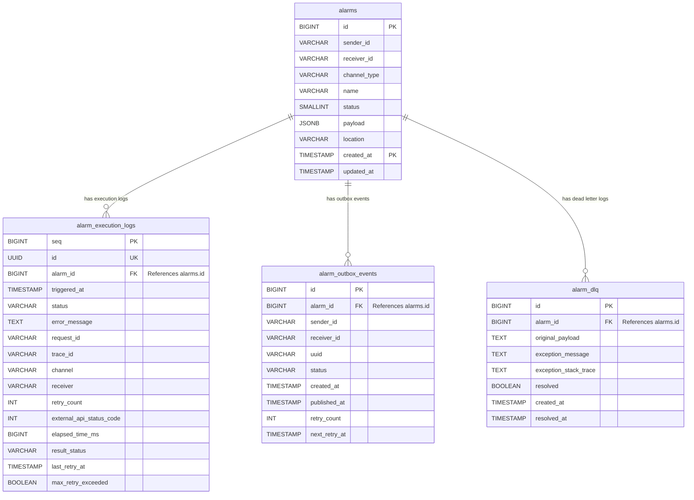

# Alarm API - Entity Relationship Diagram (ERD)

This document describes the structure of the database tables used by the Alarm API application.

## Mermaid ERD

## Table Descriptions

### 1. `alarms` (알람 마스터 테이블)
알람 발송 요청의 마스터 정보를 저장합니다. 대규모 데이터를 위한 파티셔닝(Range) 전략과 압축 최적화가 적용되었습니다.
- `id`: 알람 고유 ID (Primary Key)
- `sender_id`: 발송자 ID
- `receiver_id`: 수신자 ID
- `channel_type`: 알람 발송 채널 (예: SMS, EMAIL, PUSH 등)
- `name`: 알람명
- `status`: 현재 알람 상태 (SMALLINT 타입으로 2Byte 압축 적용)
- `payload`: 알람 발송 페이로드 (PostgreSQL JSONB / MySQL JSON 타입으로 저장하여 GIN 인덱싱 대비)
- `created_at` / `updated_at`: 생성/수정 시간 (파티셔닝 기준 컬럼이므로 Primary Key에 포함됨)

### 2. `alarm_execution_logs` (알람 실행 이력 테이블)
알람 발송 과정에서의 실행 이력 및 결과를 기록합니다. 재시도 정보 등을 포함합니다.
- `seq`: 시퀀스 번호 (Primary Key)
- `id`: 로그의 고유 UUID (Unique)
- `alarm_id`: 연관된 알람 ID
- `status` / `result_status`: 처리 상태 및 결과 상태
- `retry_count`: 재시도 횟수

### 3. `alarm_outbox_events` (아웃박스 이벤트 테이블)
트랜잭셔널 아웃박스(Transactional Outbox) 패턴을 위한 테이블입니다. 이벤트 발행 보장 목적으로 사용됩니다.
- `id`: 아웃박스 이벤트 고유 ID (Primary Key)
- `alarm_id`: 연관된 알람 ID
- `status`: 이벤트 발행 상태 (예: INIT, PUBLISHED 등)
- `retry_count`: 발행 재시도 횟수
- `next_retry_at`: 다음 발행 재시도 예정 시간

### 4. `alarm_dlq` (데드레터 큐 테이블)
정상적으로 처리되지 못하고 실패한 이벤트/메시지의 정보를 기록하여 추후 수동/자동 복구를 지원합니다.
- `id`: DLQ 고유 시퀀스 번호 (Primary Key)
- `alarm_id`: 연관된 알람 ID
- `original_payload`: 실패한 원본 메시지 페이로드
- `exception_message` / `exception_stack_trace`: 실패 사유 및 스택 트레이스
- `resolved`: 해결 여부
